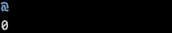

# animation 库

`animation` 提供插值轨道引擎。

---

# 目录

## 常量

| 常量                        | 说明                 | 定位                                                    |
| --------------------------- | -------------------- | ------------------------------------------------------- |
| `STEP`                      | 步进插值函数         | [STEP](#step)                                           |
| `LINEAR`                    | 线性插值函数         | [LINEAR](#linear)                                       |
| `EASE_IN_QUAD`              | 缓入快出插值函数     | [EASE_IN_QUAD](#ease_in_quad)                           |
| `EASE_OUT_QUAD`             | 快入缓出插值函数     | [EASE_OUT_QUAD](#ease_out_quad)                         |
| `EASE_IN_OUT_CUBIC`         | 慢快慢插值函数       | [EASE_IN_OUT_CUBIC](#ease_in_out_cubic)                 |
| `EASE_IN_OUT_REVERSE_CUBIC` | 快慢快插值函数       | [EASE_IN_OUT_REVERSE_CUBIC](#ease_in_out_reverse_cubic) |
| `NORMAL`                    | 正向播放             | [NORMAL](#normal)                                       |
| `REVERSE`                   | 反向播放             | [REVERSE](#reverse)                                     |
| `ALTERNATE`                 | 正反交替播放         | [ALTERNATE](#alternate)                                 |
| `ALTERNATE_REVERSE`         | 反正交替播放         | [ALTERNATE_REVERSE](#alternate_reverse)                 |
| `FORWARDS`                  | 间隔期间取当次尾帧值 | [FORWARDS](#forwards)                                   |
| `BACKWARDS`                 | 间隔期间取下次首帧值 | [BACKWARDS](#backwards)                                 |

## 方法

| 方法       | 说明                             | 定位                  |
| ---------- | -------------------------------- | --------------------- |
| `create`   | 创建一个插值轨道引擎对象         | [create](#create)     |
| `delete`   | 删除指定插值轨道引擎             | [delete](#delete)     |
| `clear`    | 删除所有插值轨道引擎             | [clear](#clear)       |
| `list`     | 获取所有插值轨道引擎信息         | [list](#list)         |
| `count`    | 返回当前插值轨道引擎的总数       | [count](#count)       |
| `sample`   | 获取当前帧插值计算的结果         | [sample](#sample)     |
| `play`     | 开始或继续插值计算               | [play](#play)         |
| `pause`    | 暂停插值计算，保留已经走过的进度 | [pause](#pause)       |
| `reset`    | 清零插值计算进度，回到未启动状态 | [reset](#reset)       |
| `replay`   | 清零插值计算进度，然后重新开始   | [replay](#replay)     |
| `set`      | 修改插值轨道引擎的参数           | [set](#set)           |
| `get_info` | 获取插值轨道引擎的完整信息表     | [get_info](#get_info) |
| `exists`   | 检查插值轨道引擎是否存在         | [exists](#exists)     |

---

# 常量

## `STEP`

步进插值函数。

### 调用

```lua
animation.STEP
```

### 可用于

- 参数 `easing`

### 示例

```lua

```

**输出：**


### 等值

```text
"step"
```

---

## `LINEAR`

线性插值函数。

### 调用

```lua
animation.LINEAR
```

### 可用于

- 参数 `easing`

### 示例

```lua

```

**输出：**


### 等值

```text
"linear"
```

### 额外说明

- 该插值函数要求传递的起始值和结束值必须可参与数学计算。

---

## `EASE_IN_QUAD`

缓入快出插值函数。

### 调用

```lua
animation.EASE_IN_QUAD
```

### 可用于

- 参数 `easing`

### 示例

```lua

```

**输出：**


### 等值

```text
"ease_in_quad"
```

### 额外说明

- 该插值函数要求传递的起始值和结束值必须可参与数学计算。

---

## `EASE_OUT_QUAD`

快入缓出插值函数。

### 调用

```lua
animation.EASE_OUT_QUAD
```

### 可用于

- 参数 `easing`

### 示例

```lua

```

**输出：**


### 等值

```text
"ease_out_quad"
```

### 额外说明

- 该插值函数要求传递的起始值和结束值必须可参与数学计算。

---

## `EASE_IN_OUT_CUBIC`

慢快慢插值函数。

### 调用

```lua
animation.EASE_IN_OUT_CUBIC
```

### 可用于

- 参数 `easing`

### 示例

```lua

```

**输出：**


### 等值

```text
"ease_in_out_cubic"
```

### 额外说明

- 该插值函数要求传递的起始值和结束值必须可参与数学计算。

---

## `EASE_IN_OUT_REVERSE_CUBIC`

快慢快插值函数。

### 调用

```lua
animation.EASE_IN_OUT_REVERSE_CUBIC
```

### 可用于

- 参数 `easing`

### 示例

```lua

```

**输出：**


### 等值

```text
"ease_in_out_reverse_cubic"
```

### 额外说明

- 该插值函数要求传递的起始值和结束值必须可参与数学计算。

---

## `NORMAL`

正向播放。

### 调用

```lua
animation.NORMAL
```

### 可用于

- 参数 `play_direction`

### 示例

```lua

```

**输出：**


### 等值

```text
"normal"
```

---

## `REVERSE`

反向播放。

### 调用

```lua
animation.REVERSE
```

### 可用于

- 参数 `play_direction`

### 示例

```lua

```

**输出：**


### 等值

```text
"reverse"
```

---

## `ALTERNATE`

正反交替播放。

### 调用

```lua
animation.ALTERNATE
```

### 可用于

- 参数 `play_direction`

### 示例

```lua

```

**输出：**


### 等值

```text
"alternate"
```

### 额外说明

- 奇数次正向播放，偶数次反向播放。

---

## `ALTERNATE_REVERSE`

反正交替播放。

### 调用

```lua
animation.ALTERNATE_REVERSE
```

### 可用于

- 参数 `play_direction`

### 示例

```lua

```

**输出：**


### 等值

```text
"alternate_reverse"
```

### 额外说明

- 偶数次正向播放，奇数次反向播放。

---

## `FORWARDS`

在间隔期间取当次播放尾帧值。

### 调用

```lua
animation.FORWARDS
```

### 可用于

- 参数 `repeat_fill_mode`

### 示例

```lua

```

**输出：**


### 等值

```text
"forwards"
```

---

## `BACKWARDS`

在间隔期间取下次播放首帧值。

### 调用

```lua
animation.BACKWARDS
```

### 可用于

- 参数 `repeat_fill_mode`

### 示例

```lua

```

**输出：**


### 等值

```text
"backwards"
```

---

# 方法

## `create`

创建一个插值轨道引擎对象。

### 调用

```lua
animation.create
```

### 参数

#### 必填参数

| 参数名     | 类型            | 说明         |
| ---------- | --------------- | ------------ |
| `duration` | integer / float | 总时长（秒） |
| `track`    | table           | 参数轨道     |

#### 选填参数

| 参数名             | 类型                               | 默认值               | 说明                   |
| ------------------ | ---------------------------------- | -------------------- | ---------------------- |
| `easing`           | table / function / const-animation | `animation.STEP`     | 插值函数               |
| `default_easing`   | table / function / const-animation | `animation.STEP`     | 默认回退插值函数       |
| `delay`            | integer / float                    | `0`                  | 首次启动延迟时长（秒） |
| `loop`             | boolean                            | `false`              | 是否循环               |
| `interval`         | integer / float                    | `0`                  | 循环之间间隔时长（秒） |
| `repeat`           | integer / const-math / nil         | `nil`                | 循环次数               |
| `play_direction`   | const-animation                    | `animation.NORMAL`   | 播放方向               |
| `repeat_fill_mode` | const-animation                    | `animation.FORWARDS` | 播放结束后的取值位置   |

### 返回值

返回一个值。

| 类型   | 说明            |
| ------ | --------------- |
| string | 插值轨道引擎 ID |

### 示例

```lua
function Init(ctx)
  local duration = 3
  an = animation.create(duration,
    {
      [1] = {
        timestamp = 0,
        key = {
          pos = 0
        }
      },
      [2] = {
        timestamp = duration,
        key = {
          pos = 10
        }
      }
    },
    {
      easing = animation.EASE_IN_OUT_CUBIC,
      loop = true,
      interval = 0.5,
      play_direction = animation.ALTERNATE
    }
  )
  animation.play(an)
end

function Render()
  local pos = math.floor(animation.sample(an, { key = "pos" }))
  draw.text(pos, 1, "@", { fg = color.BRIGHT_BLUE })
end
```

**输出：**



### 额外说明

- 必填参数 `duration` 取值范围为 $[0, 18446744073709551616]$；单位秒。
- 选填参数 `delay` 取值范围为 $[0, 18446744073709551616]$；单位秒。
- 选填参数 `interval` 取值范围为 $[0, 18446744073709551616]$；单位秒。
- 选填参数 `repeat` 取值范围为 $[1, 4294967295]$；常量 `math.POSITIVE_INFINITE` 表示无限循环。
- 选填参数 `repeat_fill_mode` 在选填参数为 `loop` 为 `false` 时恒为 `animation.FORWARDS`，传递 `animation.BACKWARDS` 不会生效。

---

## `delete`

删除指定插值轨道引擎。

### 调用

```lua
animation.delete
```

### 参数

#### 必填参数

| 参数名 | 类型   | 说明            |
| ------ | ------ | --------------- |
| `id`   | string | 插值轨道引擎 ID |

### 返回值

返回一个值。

| 类型    | 说明         |
| ------- | ------------ |
| boolean | 删除是否成功 |

### 示例

```lua
local an = animation.create(1, {})
debug.print(an)

debug.print(animation.delete(an))

debug.print(table.pretty(animation.list()))
```

**输出：**

```lua
animation_001
true
{
  n = 0
}
```

---

## `clear`

删除所有插值轨道引擎。

### 调用

```lua
animation.clear
```

### 返回值

返回一个值。

| 类型    | 说明         |
| ------- | ------------ |
| boolean | 删除是否成功 |

### 示例

```lua
animation.create(20, {})
animation.create(30, {})
animation.create(40, {})
animation.create(50, {})

debug.print(animation.clear())

debug.print(table.pretty(animation.list()))
```

**输出：**

```lua
true
{
  n = 0
}
```

---

## `list`

获取所有插值轨道引擎信息。

### 调用

```lua
animation.list
```

### 返回值

返回一个值。

| 类型  | 说明                         |
| ----- | ---------------------------- |
| table | 所有插值轨道引擎信息的混合表 |

### 示例

```lua
local an = animation.create(1, {})

debug.print(table.pretty(animation.list()))
```

**输出：**

```lua
{
  [1] = {
    id = "animation_001",
    duration = 1,
    track = {},
    easing = "step",
    default_easing = "step",
    delay = 0,
    loop = false,
    interval = 0,
    repeat = nil,
    play_direction = "normal",
    repeat_fill_mode = "forwards",
    state = "idle",
    elapsed = 0,
    executed_count = 0,
    remaining = 1
  },
  n = 1
}
```

### 额外说明

- 返回值混合表结构如下：

```lua
{
  {
    id = "animation_001",          -- string（插值轨道引擎 ID）
    duration = 1,                  -- integer（总时长）
    track = {},                    -- table（参数轨道）
    easing = "step",               -- string / table / function（插值函数）
    default_easing = "step",       -- string / table / function（默认回退插值函数）
    delay = 0,                     -- integer（首次启动延迟时长）
    loop = false,                  -- boolean（是否循环）
    interval = 0,                  -- integer（循环之间间隔时长）
    repeat = nil,                  -- integer / string / nil（循环次数）
    play_direction = "normal",     -- string（播放方向）
    repeat_fill_mode = "forwards", -- string（播放结束后的取值位置）
    state = "idle"                 -- string（当前计时器状态）
    elapsed = 0,                   -- integer（当轮计时已过时长）
    executed_count = 0,            -- integer（当前计时器已循环次数）
    remaining = 1,                 -- integer / float（距离下次触发还剩多久）
  },
  n = 1,                           -- integer（插值轨道引擎数量）
}
```

---

## `count`

返回当前插值轨道引擎的总数。

### 调用

```lua
animation.count
```

### 返回值

返回一个值。

| 类型    | 说明             |
| ------- | ---------------- |
| integer | 插值轨道引擎总数 |

### 示例

```lua
animation.create(1, {})
animation.create(1, {})

debug.print(animation.count())
```

**输出：**

```lua
2
```

---

## `sample`

获取当前帧插值计算的结果。

### 调用

```lua
animation.sample
```

### 参数

#### 必填参数

| 参数名 | 类型   | 说明          |
| ------ | ------ | ------------- |
| `id`   | string | 插值计算器 ID |

#### 选填参数

| 参数名 | 类型         | 默认值 | 说明                   |
| ------ | ------------ | ------ | ---------------------- |
| `key`  | string / nil | `nil`  | 获取指定的参数插值结果 |

### 返回值

**若未填写选填参数 `key`**，返回一个值。

| 类型   | 说明                                   |
| ------ | -------------------------------------- |
| table` | 所有参数在当前帧插值计算后的结果对象表 |

**若填写选填参数 `key`**，返回一个值。

| 类型 | 说明                             |
| ---- | -------------------------------- |
| any  | 指定参数在当前帧插值计算后的结果 |

**若轨道无任何定义或指定不存在的键**，返回一个值。

| 类型 | 说明           |
| ---- | -------------- |
| nil  | 无插值计算结果 |

### 示例

```lua
function Init(ctx)
  local duration = 3
  an = animation.create(duration,
    {
      [1] = {
        timestamp = 0,
        key = {
          pos = 0
        }
      },
      [2] = {
        timestamp = duration,
        key = {
          pos = 10
        }
      }
    },
    {
      easing = animation.EASE_IN_OUT_CUBIC,
      loop = true,
      interval = 0.5,
      play_direction = animation.ALTERNATE
    }
  )
  animation.play(an)
end

function Render()
  local pos = math.floor(animation.sample(an, { key = "pos" }))
  draw.text(pos, 1, "@", { fg = color.BRIGHT_BLUE })
end
```

**输出：**


---

## `play`

开始或继续插值计算。

### 调用

```lua
animation.play
```

### 参数

#### 必填参数

| 参数名 | 类型   | 说明          |
| ------ | ------ | ------------- |
| `id`   | string | 插值计算器 ID |

### 返回值

返回一个值。

| 类型    | 说明               |
| ------- | ------------------ |
| boolean | 开始或继续是否成功 |

### 示例

```lua
local duration = 3
local an = animation.create(duration, {})
debug.print(animation.play(an))
local info = animation.get_info(an)
debug.print(info.state)
```

**输出：**

```lua
true
running
```

---

## `pause`

暂停插值计算，保留已经走过的进度。

### 调用

```lua
animation.pause
```

### 参数

#### 必填参数

| 参数名 | 类型   | 说明          |
| ------ | ------ | ------------- |
| `id`   | string | 插值计算器 ID |

### 返回值

返回一个值。

| 类型    | 说明         |
| ------- | ------------ |
| boolean | 暂停是否成功 |

### 示例

```lua
local duration = 3
local an = animation.create(duration, {})
animation.play(an)
debug.print(animation.pause(an))
local info = animation.get_info(an)
debug.print(info.state)
```

**输出：**

```lua
true
paused
```

---

## `reset`

清零插值计算进度，回到未启动状态。

### 调用

```lua
animation.reset
```

### 参数

#### 必填参数

| 参数名 | 类型   | 说明          |
| ------ | ------ | ------------- |
| `id`   | string | 插值计算器 ID |

### 返回值

返回一个值。

| 类型    | 说明         |
| ------- | ------------ |
| boolean | 设置是否成功 |

### 示例

```lua
local duration = 3
local an = animation.create(duration, {})
animation.play(an)
debug.print(animation.reset(an))
local info = animation.get_info(an)
debug.print(info.state)
```

**输出：**

```lua
true
idle
```

---

## `replay`

清零插值计算进度，然后重新开始。

### 调用

```lua
animation.replay
```

### 参数

#### 必填参数

| 参数名 | 类型   | 说明          |
| ------ | ------ | ------------- |
| `id`   | string | 插值计算器 ID |

### 返回值

返回一个值。

| 类型    | 说明         |
| ------- | ------------ |
| boolean | 设置是否成功 |

### 示例

```lua
local duration = 3
local an = animation.create(duration, {})
animation.play(an)
debug.print(animation.replay(an))
local info = animation.get_info(an)
debug.print(info.state)
```

**输出：**

```lua
true
running
```

---

## `set`

修改插值轨道引擎的参数。

### 调用

```lua
animation.set
```

### 参数

#### 必填参数

| 参数名 | 类型   | 说明            |
| ------ | ------ | --------------- |
| `id`   | string | 插值轨道引擎 ID |

#### 选填参数

| 参数名             | 类型                               | 默认值   | 说明                   |
| ------------------ | ---------------------------------- | -------- | ---------------------- |
| `duration`         | integer / float                    | 保持原值 | 总时长（秒）           |
| `track`            | table                              | 保持原值 | 参数轨道               |
| `easing`           | table / function / const-animation | 保持原值 | 插值函数               |
| `default_easing`   | table / function / const-animation | 保持原值 | 默认回退插值函数       |
| `delay`            | integer / float                    | 保持原值 | 首次启动延迟时长（秒） |
| `loop`             | boolean                            | 保持原值 | 是否循环               |
| `interval`         | integer / float                    | 保持原值 | 循环之间间隔时长（秒） |
| `repeat`           | integer / const-math / nil         | 保持原值 | 循环次数               |
| `play_direction`   | const-animation                    | 保持原值 | 播放方向               |
| `repeat_fill_mode` | const-animation                    | 保持原值 | 播放结束后的取值位置   |

### 返回值

返回一个值。

| 类型    | 说明         |
| ------- | ------------ |
| boolean | 修改是否成功 |

### 示例

```lua
local an = animation.create(10, {})

debug.print(animation.set(an, { duration = 5 }))

debug.print(table.pretty(animation.get_info(an)))
```

**输出：**

```lua
true
{
  id = "animation_001",
  duration = 5,
  track = {},
  easing = "step",
  default_easing = "step",
  delay = 0,
  loop = false,
  interval = 0,
  repeat = nil,
  play_direction = "normal",
  repeat_fill_mode = "forwards",
  state = "idle",
  elapsed = 0,
  executed_count = 0,
  remaining = 1
}
```

### 额外说明

- 选填参数 `duration` 取值范围为 $[0, 18446744073709551616]$；单位秒。
- 选填参数 `delay` 取值范围为 $[0, 18446744073709551616]$；单位秒。
- 选填参数 `interval` 取值范围为 $[0, 18446744073709551616]$；单位秒。
- 选填参数 `repeat` 取值范围为 $[1, 4294967295]$；常量 `math.POSITIVE_INFINITE` 表示无限循环。
- 选填参数 `repeat_fill_mode` 在选填参数为 `loop` 为 `false` 时恒为 `animation.FORWARDS`，传递 `animation.BACKWARDS` 不会生效。

---

## `get_info`

获取插值轨道引擎的完整信息表。

### 调用

```lua
animation.get_info
```

### 参数

#### 必填参数

| 参数名 | 类型   | 说明            |
| ------ | ------ | --------------- |
| `id`   | string | 插值轨道引擎 ID |

### 返回值

**该插值轨道引擎存在时**，返回一个值。

| 类型  | 说明                     |
| ----- | ------------------------ |
| table | 该插值轨道引擎信息对象表 |

**该插值轨道引擎不存在时**，返回一个值。

| 类型 | 说明                 |
| ---- | -------------------- |
| nil  | 不存在该插值轨道引擎 |

### 示例

```lua
local an = animation.create(10, {})

debug.print(table.pretty(animation.get_info(an)))
```

**输出：**

```lua
{
  id = "animation_001",
  duration = 10,
  track = {},
  easing = "step",
  default_easing = "step",
  delay = 0,
  loop = false,
  interval = 0,
  repeat = nil,
  play_direction = "normal",
  repeat_fill_mode = "forwards",
  state = "idle",
  elapsed = 0,
  executed_count = 0,
  remaining = 1
}
```

### 额外说明

- 返回对象表包含以下字段：

```lua
{
  id = "animation_001",          -- string（插值轨道引擎 ID）
  duration = 10,                  -- integer（总时长）
  track = {},                    -- table（参数轨道）
  easing = "step",               -- string / table / function（插值函数）
  default_easing = "step",       -- string / table / function（默认回退插值函数）
  delay = 0,                     -- integer（首次启动延迟时长）
  loop = false,                  -- boolean（是否循环）
  interval = 0,                  -- integer（循环之间间隔时长）
  repeat = nil,                  -- integer / string / nil（循环次数）
  play_direction = "normal",     -- string（播放方向）
  repeat_fill_mode = "forwards", -- string（播放结束后的取值位置）
  state = "idle"                 -- string（当前计时器状态）
  elapsed = 0,                   -- integer（当轮计时已过时长）
  executed_count = 0,            -- integer（当前计时器已循环次数）
  remaining = 1,                 -- integer / float（距离下次触发还剩多久）
}
```

---

## `exists`

检查插值轨道引擎是否存在。

### 调用

```lua
animation.exists
```

### 参数

#### 必填参数

| 参数名 | 类型   | 说明            |
| ------ | ------ | --------------- |
| `id`   | string | 插值轨道引擎 ID |

### 返回值

返回一个值。

| 类型    | 说明                   |
| ------- | ---------------------- |
| boolean | 该插值轨道引擎是否存在 |

### 示例

```lua
local an = animation.create(10, {})
debug.print(animation.exists(an))

animation.delete(an)
debug.print(animation.exists(an))
```

**输出：**

```lua
true
false
```
