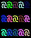

# effect 库

`effect` 提供对画布字符着色器。

---

# 目录

## 常量

| 常量     | 说明                         | 定位              |
| -------- | ---------------------------- | ----------------- |
| `CANVAS` | 着色器作用于合成后的完整画布 | [CANVAS](#canvas) |
| `SLICE`  | 着色器作用于指定图层切片     | [SLICE](#slice)   |

## 方法

| 方法       | 说明                             | 定位                  |
| ---------- | -------------------------------- | --------------------- |
| `chars`    | 获取指定区域的所有字符格信息     | [chars](#chars)       |
| `effect`   | 使用临时字符着色器作用于区域字符 | [effect](#effect)     |
| `create`   | 创建一个字符着色器对象           | [create](#create)     |
| `delete`   | 删除指定字符着色器               | [delete](#delete)     |
| `clear`    | 删除所有字符着色器               | [clear](#clear)       |
| `list`     | 获取所有字符着色器信息           | [list](#list)         |
| `count`    | 返回当前字符着色器的总数         | [count](#count)       |
| `apply`    | 应用字符着色器                   | [apply](#apply)       |
| `set`      | 修改字符着色器的参数             | [set](#set)           |
| `get_info` | 获取字符着色器的完整信息表       | [get_info](#get_info) |
| `exists`   | 检查字符着色器是否存在           | [exists](#exists)     |

---

# 常量

## `CANVAS`

着色器作用于合成后的完整画布。

### 调用

```lua
effect.CANVAS
```

### 可用于

- 参数 `scope`

### 示例

```lua
function Init(ctx)
  s1 = slice.create(5, 3, { bg = color.BRIGHT_BLUE })
  s2 = slice.create(5, 3, { bg = color.BRIGHT_RED })
end

function Render()
  draw.text(0, 1, "@@@@@", { slice_layer = s1 })
  draw.text(0, 1, "$$$$$", { slice_layer = s2 })

  slice.draw(s1, 0, 0)
  slice.draw(s2, 3, 0)

  effect.effect(0, 0, 8, 3, {
    process = function(char)
      char.fg = color.BRIGHT_GREEN
      return char
    end,
    scope = effect.CANVAS
  })
end
```

**输出：**


### 等值

```text
"canvas"
```

---

## `SLICE`

着色器作用于指定图层切片。

### 调用

```lua
effect.SLICE
```

### 可用于

- 参数 `scope`

### 示例

```lua
function Init(ctx)
  s1 = slice.create(5, 3, { bg = color.BRIGHT_BLUE })
  s2 = slice.create(5, 3, { bg = color.BRIGHT_RED })
end

function Render()
  draw.text(0, 1, "@@@@@", { slice_layer = s1 })
  draw.text(0, 1, "$$$$$", { slice_layer = s2 })

  slice.draw(s1, 0, 0)
  slice.draw(s2, 3, 0)

  effect.effect(0, 0, 5, 3, {
    process = function(char)
      char.fg = color.BRIGHT_GREEN
      return char
    end,
    scope = effect.SLICE,
    slice_layer = s1
  })
end
```

**输出：**


### 等值

```text
"slice"
```

---

# 方法

## `chars`

获取指定区域的所有字符格信息。

### 调用

```lua
effect.chars
```

### 参数

#### 必填参数

| 参数名   | 类型    | 说明                    |
| -------- | ------- | ----------------------- |
| `x`      | integer | 作用区域左上角的 x 坐标 |
| `y`      | integer | 作用区域左上角的 y 坐标 |
| `width`  | integer | 作用区域宽度            |
| `height` | integer | 作用区域高度            |

#### 选填参数

| 参数                   | 类型         | 默认值          | 含义                 |
| ---------------------- | ------------ | --------------- | -------------------- |
| `include_continuation` | boolean      | `false`         | 占位符是否命中宽字符 |
| `scope`                | const-effect | `effect.CANVAS` | 作用层级             |
| `slice_layer`          | string       | `"base"`        | 作用目标图层切片     |

### 返回值

返回一个值。

| 类型  | 说明                   |
| ----- | ---------------------- |
| table | 所选区域的所有字符信息 |

### 示例

```lua
local is_draw = false
local is_print = false

function Update()
  if is_draw and not is_print then
    local chars = effect.chars(5, 2, 2, 1)
    debug.print(table.pretty(chars))
    is_print = true
  end
end

function Render()
  draw.text(5, 2, "@", { fg = color.BRIGHT_BLUE })
  draw.text(6, 2, "@", { fg = color.BRIGHT_RED })
  is_draw = true
end
```

**输出：**

```lua
{
  [1] = {
    char = "@",
    x = 5,
    y = 2,
    fg = "bright_blue",
    bg = "none",
    bold = false,
    italic = false,
    underline = false,
    strike = false,
    blink = false,
    reverse = false,
    hidden = false,
    dim = false
  },
  [2] = {
    char = "@",
    x = 5,
    y = 2,
    fg = "bright_red",
    bg = "none",
    bold = false,
    italic = false,
    underline = false,
    strike = false,
    blink = false,
    reverse = false,
    hidden = false,
    dim = false
  },
  n = 2
}
```

### 额外说明

- 必填参数 `x` 取值范围为 $[-2147483648, 2147483647]$。
- 必填参数 `y` 取值范围为 $[-2147483648, 2147483647]$。
- 必填参数 `width` 取值范围为 $[1, 65535]$。
- 必填参数 `height` 取值范围为 $[1, 65535]$。
- 当选填参数 `scope` 为 `effect.CANVAS` 时，选填参数 `slice_layer` 会被忽略。
- 返回值混合表结构如下：

```lua
{
  {
    char = "@",         -- string（字符）
    x = 5,              -- string（当前字符起始x坐标）
    y = 2,              -- string（当前字符起始y坐标）
    fg = "bright_blue", -- string（前景色）
    bg = "none",        -- string（背景色）
    bold = false,       -- boolean（加粗）
    italic = false,     -- boolean（斜体）
    underline = false,  -- boolean（下划线）
    strike = false,     -- boolean（删除线）
    blink = false,      -- boolean（闪烁）
    reverse = false,    -- boolean（反转）
    hidden = false,     -- boolean（隐藏）
    dim = false         -- boolean（暗淡）
  },
  n = 1,                -- integer（字符数量）
}
```

---

## `effect`

使用临时字符着色器作用于区域字符。

### 调用

```lua
effect.effect
```

### 参数

#### 必填参数

| 参数名   | 类型    | 说明                    |
| -------- | ------- | ----------------------- |
| `x`      | integer | 作用区域左上角的 x 坐标 |
| `y`      | integer | 作用区域左上角的 y 坐标 |
| `width`  | integer | 作用区域宽度            |
| `height` | integer | 作用区域高度            |

#### 选填参数

| 参数                   | 类型           | 默认值          | 含义                 |
| ---------------------- | -------------- | --------------- | -------------------- |
| `process`              | function / nil | `nil`           | 处理函数             |
| `scope`                | const-effect   | `effect.CANVAS` | 作用层级             |
| `include_continuation` | boolean        | `false`         | 占位符是否命中宽字符 |
| `slice_layer`          | string         | `"base"`        | 作用目标图层切片     |

### 返回值

无返回值。

### 示例

```lua
draw.text(5, 2, "@@@@@\n@@@@@\n@@@@@")
effect.effect(5, 2, 5, 3, {
  process = function(char)
    local r, g, b = random.randint({ min = 0, max = 255 }), random.randint({ min = 0, max = 255 }), random.randint({ min = 0, max = 255 })
    char.fg = color.rgb(r, g, b)
    return char
  end
})
```

**输出：**



### 额外说明

- 必填参数 `x` 取值范围为 $[-2147483648, 2147483647]$。
- 必填参数 `y` 取值范围为 $[-2147483648, 2147483647]$。
- 必填参数 `width` 取值范围为 $[1, 65535]$。
- 必填参数 `height` 取值范围为 $[1, 65535]$。
- 当选填参数 `scope` 为 `effect.CANVAS` 时，选填参数 `slice_layer` 会被忽略。
- 选填参数 `process` 处理函数详细用法见⌊[字符着色器](../education/EFFECT.md)⌉。

---

## `create`

创建一个字符着色器对象。

### 调用

```lua
effect.create
```

### 参数

#### 必填参数

| 参数名   | 类型    | 说明         |
| -------- | ------- | ------------ |
| `width`  | integer | 作用区域宽度 |
| `height` | integer | 作用区域高度 |

#### 选填参数

| 参数                   | 类型           | 默认值          | 含义                 |
| ---------------------- | -------------- | --------------- | -------------------- |
| `process`              | function / nil | `nil`           | 处理函数             |
| `scope`                | const-effect   | `effect.CANVAS` | 作用层级             |
| `include_continuation` | boolean        | `false`         | 占位符是否命中宽字符 |

### 返回值

返回一个值。

| 类型   | 说明          |
| ------ | ------------- |
| string | 字符着色器 ID |

### 示例

```lua
function Init(ctx)
  ef = effect.create(5, 3, {
  process = function(char)
    local r, g, b = random.randint({ min = 0, max = 255 }), random.randint({ min = 0, max = 255 }), random.randint({ min = 0, max = 255 })
    char.fg = color.rgb(r, g, b)
    return char
  end
})
end

function Render()
  draw.text(5, 2, "@@@@@\n@@@@@\n@@@@@")
  effect.apply(ef, 5, 2)
end
```

**输出：**


### 额外说明

- 必填参数 `width` 取值范围为 $[1, 65535]$。
- 必填参数 `height` 取值范围为 $[1, 65535]$。

---

## `delete`

删除指定字符着色器。

### 调用

```lua
effect.delete
```

### 参数

#### 必填参数

| 参数名 | 类型   | 说明          |
| ------ | ------ | ------------- |
| `id`   | string | 字符着色器 ID |

### 返回值

返回一个值。

| 类型    | 说明         |
| ------- | ------------ |
| boolean | 删除是否成功 |

### 示例

```lua
local ef = effect.create(20, 10)
debug.print(ef)

debug.print(effect.delete(ef))

debug.print(table.pretty(effect.list()))
```

**输出：**

```lua
effect_001
true
{
  n = 0
}
```

---

## `clear`

删除所有字符着色器。

### 调用

```lua
effect.clear
```

### 返回值

返回一个值。

| 类型    | 说明         |
| ------- | ------------ |
| boolean | 删除是否成功 |

### 示例

```lua
effect.create(20, 10)
effect.create(30, 8)
effect.create(40, 6)
effect.create(50, 4)

debug.print(effect.clear())

debug.print(table.pretty(effect.list()))
```

**输出：**

```lua
true
{
  n = 0
}
```

---

## `list`

获取所有字符着色器信息。

### 调用

```lua
effect.list
```

### 返回值

返回一个值。

| 类型  | 说明                       |
| ----- | -------------------------- |
| table | 所有字符着色器信息的混合表 |

### 示例

```lua
local ef = effect.create(20, 10)

debug.print(table.pretty(effect.list()))
```

**输出：**

```lua
{
  [1] = {
    id = "effect_001",
    width = 20,
    height = 10,
    process = <function>,
    scope = "canvas",
    include_continuation = false
  },
  n = 1
}
```

### 额外说明

- 返回值混合表结构如下：

```lua
{
  {
    id = "effect_001",           -- string（字符着色器 ID）
    width = 20,                  -- integer（作用区域宽度）
    height = 10,                 -- integer（作用区域高度）
    process = <function>,        -- function（处理函数）
    scope = "canvas",            -- string（作用层级）
    include_continuation = false -- boolean（占位符是否命中宽字符）
  },
  n = 1,                         -- integer（字符着色器数量）
}
```

---

## `count`

返回当前字符着色器的总数。

### 调用

```lua
effect.count
```

### 返回值

返回一个值。

| 类型    | 说明           |
| ------- | -------------- |
| integer | 字符着色器总数 |

### 示例

```lua
effect.create(20, 10)
effect.create(30, 8)

debug.print(effect.count())
```

**输出：**

```lua
2
```

---

## `apply`

应用字符着色器。

### 调用

```lua
effect.apply
```

### 参数

#### 必填参数

| 参数名 | 类型    | 说明                          |
| ------ | ------- | ----------------------------- |
| `id`   | string  | 字符着色器 ID                 |
| `x`    | integer | 字符着色器左上角位置的 x 坐标 |
| `y`    | integer | 字符着色器左上角位置的 y 坐标 |

#### 选填参数

| 参数名        | 类型   | 默认值   | 说明             |
| ------------- | ------ | -------- | ---------------- |
| `slice_layer` | string | `"base"` | 绘制目标图层切片 |

### 返回值

无返回值。

### 示例

```lua
function Init(ctx)
  ef = effect.create(5, 3, {
  process = function(char)
    local r, g, b = random.randint({ min = 0, max = 255 }), random.randint({ min = 0, max = 255 }), random.randint({ min = 0, max = 255 })
    char.fg = color.rgb(r, g, b)
    return char
  end
})
end

function Render()
  draw.text(5, 2, "@@@@@\n@@@@@\n@@@@@")
  effect.apply(ef, 5, 2)
end
```

**输出：**


### 额外说明

- 必填参数 `x` 取值范围为 $[-2147483648, 2147483647]$。
- 必填参数 `y` 取值范围为 $[-2147483648, 2147483647]$。
- 选填参数 `slice_layer` 仅在当前着色器对象的配置字段 `scope` 为 `effect.SLICE` 时生效。

---

## `set`

修改字符着色器的参数。

### 调用

```lua
effect.set
```

### 参数

#### 必填参数

| 参数名 | 类型   | 说明          |
| ------ | ------ | ------------- |
| `id`   | string | 字符着色器 ID |

#### 选填参数

| 参数                   | 类型           | 默认值   | 含义                 |
| ---------------------- | -------------- | -------- | -------------------- |
| `width`                | integer        | 保持原值 | 作用区域宽度         |
| `height`               | integer        | 保持原值 | 作用区域高度         |
| `process`              | function / nil | 保持原值 | 处理函数             |
| `scope`                | const-effect   | 保持原值 | 作用层级             |
| `include_continuation` | boolean        | 保持原值 | 占位符是否命中宽字符 |

### 返回值

返回一个值。

| 类型    | 说明         |
| ------- | ------------ |
| boolean | 修改是否成功 |

### 示例

```lua
local ef = effect.create(20, 10)

debug.print(effect.set(ef, { width = 25, height = 5 }))

debug.print(table.pretty(effect.get_info(ef)))
```

**输出：**

```lua
true
{
  id = "effect_001",
  width = 25,
  height = 5,
  process = <function>,
  scope = "canvas",
  include_continuation = false
}
```

### 额外说明

- 选填参数 `width` 取值范围为 $[1, 65535]$。
- 选填参数 `height` 取值范围为 $[1, 65535]$。

---

## `get_info`

获取字符着色器的完整信息表。

### 调用

```lua
effect.get_info
```

### 参数

#### 必填参数

| 参数名 | 类型   | 说明          |
| ------ | ------ | ------------- |
| `id`   | string | 字符着色器 ID |

### 返回值

**该字符着色器存在时**，返回一个值。

| 类型  | 说明                   |
| ----- | ---------------------- |
| table | 该字符着色器信息对象表 |

**该字符着色器不存在时**，返回一个值。

| 类型 | 说明               |
| ---- | ------------------ |
| nil  | 不存在该字符着色器 |

### 示例

```lua
local ef = effect.create(20, 10)

debug.print(table.pretty(effect.get_info(ef)))
```

**输出：**

```lua
{
  id = "effect_001",
  width = 20,
  height = 10,
  process = <function>,
  scope = "canvas",
  include_continuation = false
}
```

### 额外说明

- 返回对象表包含以下字段：

```lua
{
  id = "effect_001",           -- string（字符着色器 ID）
  width = 20,                  -- integer（作用区域宽度）
  height = 10,                 -- integer（作用区域高度）
  process = <function>,        -- function（处理函数）
  scope = "canvas",            -- string（作用层级）
  include_continuation = false -- boolean（占位符是否命中宽字符）
}
```

---

## `exists`

检查字符着色器是否存在。

### 调用

```lua
effect.exists
```

### 参数

#### 必填参数

| 参数名 | 类型   | 说明          |
| ------ | ------ | ------------- |
| `id`   | string | 字符着色器 ID |

### 返回值

返回一个值。

| 类型    | 说明                 |
| ------- | -------------------- |
| boolean | 该字符着色器是否存在 |

### 示例

```lua
local ef = effect.create(20, 10)
debug.print(effect.exists(ef))

effect.delete(ef)
debug.print(effect.exists(ef))
```

**输出：**

```lua
true
false
```
