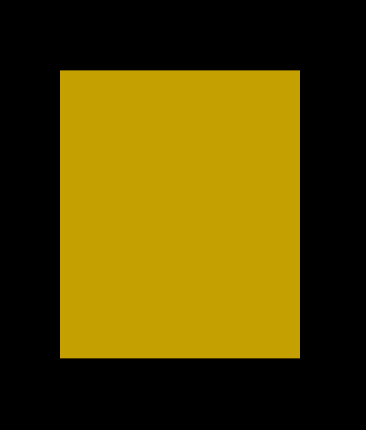

# slice 库

`slice` 用于创建和管理图层切片对象。

---

# 目录

## 方法

| 方法       | 说明                     | 定位                  |
| ---------- | ------------------------ | --------------------- |
| `create`   | 创建一个图层切片对象     | [create](#create)     |
| `delete`   | 删除指定图层切片         | [delete](#delete)     |
| `clear`    | 删除所有图层切片         | [clear](#clear)       |
| `list`     | 获取所有图层切片信息     | [list](#list)         |
| `count`    | 返回当前图层切片的总数   | [count](#count)       |
| `draw`     | 绘制图层切片             | [draw](#draw)         |
| `set`      | 修改图层切片的参数       | [set](#set)           |
| `get_info` | 获取图层切片的完整信息表 | [get_info](#get_info) |
| `exists`   | 检查图层切片是否存在     | [exists](#exists)     |

---

# 方法

## `create`

创建一个图层切片对象。

### 调用

```lua
slice.create
```

### 参数

#### 必填参数

| 参数名   | 类型    | 说明         |
| -------- | ------- | ------------ |
| `width`  | integer | 图层切片宽度 |
| `height` | integer | 图层切片高度 |

#### 选填参数

| 参数名              | 类型                 | 默认值       | 说明                                           |
| ------------------- | -------------------- | ------------ | ---------------------------------------------- |
| `bg`                | string / const-color | `color.NONE` | 图层切片背景颜色                               |
| `layer`             | integer              | 自动向上递增 | 图层切片层级                                   |
| `event_passthrough` | boolean              | `false`      | 本层没有控件命中时，是否允许控件事件穿透到下层 |

### 返回值

返回一个值。

| 类型   | 说明        |
| ------ | ----------- |
| string | 图层切片 ID |

### 示例

```lua
function Init(ctx)
  s = slice.create(20, 10, { bg = color.YELLOW })
end

function Render()
  slice.draw(s, 5, 2)
end
```

**输出：**



### 额外说明

- 图层切片层级之间不允许空洞图层，选填参数 `layer` 超过最大层级时自动修正为置顶。
- 插入层级会自动将后面的图层切片层级向上递增。
- 必填参数 `width` 取值范围为 $[1, 65535]$。
- 必填参数 `height` 取值范围为 $[1, 65535]$。
- 选填参数 `layer` 取值范围为 $[1, 2147483647]$。

---

## `delete`

删除指定图层切片。

### 调用

```lua
slice.delete
```

### 参数

#### 必填参数

| 参数名 | 类型   | 说明        |
| ------ | ------ | ----------- |
| `id`   | string | 图层切片 ID |

### 返回值

返回一个值。

| 类型    | 说明         |
| ------- | ------------ |
| boolean | 删除是否成功 |

### 示例

```lua
local s = slice.create(20, 10, { bg = color.YELLOW })
debug.print(s)

debug.print(slice.delete(s))

debug.print(table.pretty(slice.list()))
```

**输出：**

```lua
slice_001
true
{
  n = 0
}
```

### 额外说明

- `"base"` 图层不可删除，传入 `"base"` 时返回 `false`。
- 删除位于层级中间的图层切片会自动将后面的图层切片层级向前移动。

---

## `clear`

删除所有图层切片。

### 调用

```lua
slice.clear
```

### 返回值

返回一个值。

| 类型    | 说明         |
| ------- | ------------ |
| boolean | 删除是否成功 |

### 示例

```lua
slice.create(20, 10, { bg = color.YELLOW })
slice.create(30, 8, { bg = color.RED })
slice.create(40, 6, { bg = color.GREEN })
slice.create(50, 4, { bg = color.BLUE })

debug.print(slice.clear())

debug.print(table.pretty(slice.list()))
```

**输出：**

```lua
true
{
  n = 0
}
```

---

## `list`

获取所有图层切片信息。

### 调用

```lua
slice.list
```

### 返回值

返回一个值。

| 类型  | 说明                     |
| ----- | ------------------------ |
| table | 所有图层切片信息的混合表 |

### 示例

```lua
local s1 = slice.create(20, 10, { bg = color.YELLOW })
local s2 = slice.create(30, 8, { bg = color.RED })

debug.print(table.pretty(slice.list()))
```

**输出：**

```lua
{
  [1] = {
    id = "slice_001",
    width = 20,
    height = 10,
    bg = "yellow",
    layer = 1,
    event_passthrough = false
  },
  [2] = {
    id = "slice_002",
    width = 30,
    height = 8,
    bg = "red",
    layer = 2,
    event_passthrough = false
  },
  n = 2
}
```

### 额外说明

- 返回值混合表结构如下：

```lua
{
  {
    id = "slice_001",         -- string（图层切片 ID）
    width = 20,               -- integer（图层切片宽度）
    height = 10,              -- integer（图层切片高度）
    bg = "yellow",            -- string（图层切片背景颜色）
    layer = 1,                -- integer（图层图层切片序号）
    event_passthrough = false -- boolean（控件事件是否穿透）
  },
  n = 1,                      -- integer（图层切片数量）
}
```

- 返回值混合表按照图层切片层级依次排序。
- 返回值混合表不包含 `"base"` 图层。

---

## `count`

返回当前图层切片的总数。

### 调用

```lua
slice.count
```

### 返回值

返回一个值。

| 类型    | 说明         |
| ------- | ------------ |
| integer | 图层切片总数 |

### 示例

```lua
slice.create(20, 10, { bg = color.YELLOW })
slice.create(30, 8, { bg = color.RED })

debug.print(slice.count())
```

**输出：**

```lua
2
```

### 额外说明

- 返回值数字不包含 `"base"` 图层。

---

## `draw`

绘制图层切片。

### 调用

```lua
slice.draw
```

### 参数

#### 必填参数

| 参数名 | 类型    | 说明                        |
| ------ | ------- | --------------------------- |
| `id`   | string  | 图层切片 ID                 |
| `x`    | integer | 图层切片左上角位置的 x 坐标 |
| `y`    | integer | 图层切片左上角位置的 y 坐标 |

#### 选填参数

| 参数名 | 类型 | 默认值 | 说明 |
| ------ | ---- | ------ | ---- |
| `slice_layer` | string | `"base"` | 父切片或滚动框 ID |

### 返回值

无返回值。

### 示例

```lua
function Init(ctx)
  s = slice.create(20, 10, { bg = color.YELLOW })
end

function Render()
  slice.draw(s, 5, 2)
end
```

**输出：**


### 额外说明

- 位置相对于父容器的内容坐标。子切片按自己的固定 `layer` 排序，并受祖先内容区域裁剪；禁止父子循环引用。
- 必填参数 `x` 取值范围为 $[-2147483648, 2147483647]$。
- 必填参数 `y` 取值范围为 $[-2147483648, 2147483647]$。

---

## `set`

修改图层切片的参数。

### 调用

```lua
slice.set
```

### 参数

#### 必填参数

| 参数名 | 类型   | 说明        |
| ------ | ------ | ----------- |
| `id`   | string | 图层切片 ID |

#### 选填参数

| 参数名              | 类型                 | 默认值   | 说明                                           |
| ------------------- | -------------------- | -------- | ---------------------------------------------- |
| `width`             | integer              | 保持原值 | 图层切片宽度                                   |
| `height`            | integer              | 保持原值 | 图层切片高度                                   |
| `bg`                | string / const-color | 保持原值 | 图层切片背景颜色                               |
| `layer`             | integer              | 保持原值 | 图层切片层级                                   |
| `event_passthrough` | boolean              | 保持原值 | 本层没有控件命中时，是否允许控件事件穿透到下层 |

### 返回值

返回一个值。

| 类型    | 说明         |
| ------- | ------------ |
| boolean | 修改是否成功 |

### 示例

```lua
local s = slice.create(20, 10, { bg = color.YELLOW })

debug.print(slice.set(s, { width = 25, height = 5, bg = color.BLUE }))

debug.print(table.pretty(slice.get_info(s)))
```

**输出：**

```lua
true
{
  id = "slice_001",
  width = 25,
  height = 5,
  bg = "blue",
  layer = 1,
  event_passthrough = false
}
```

### 额外说明

- `"base"` 图层不可修改。
- 图层层级之间不允许空洞图层，选填参数 `layer` 超过最大层级时自动修正为置顶。
- 选填参数 `width` 取值范围为 $[1, 65535]$。
- 选填参数 `height` 取值范围为 $[1, 65535]$。
- 选填参数 `layer` 取值范围为 $[1, 2147483647]$。

---

## `get_info`

获取图层切片的完整信息表。

### 调用

```lua
slice.get_info
```

### 参数

#### 必填参数

| 参数名 | 类型   | 说明        |
| ------ | ------ | ----------- |
| `id`   | string | 图层切片 ID |

### 返回值

**该图层切片存在时**，返回一个值。

| 类型  | 说明                 |
| ----- | -------------------- |
| table | 该图层切片信息对象表 |

**该图层切片不存在时**，返回一个值。

| 类型 | 说明             |
| ---- | ---------------- |
| nil  | 不存在该图层切片 |

### 示例

```lua
local s = slice.create(20, 10, { bg = color.YELLOW })

debug.print(table.pretty(slice.get_info(s)))
```

**输出：**

```lua
{
  id = "slice_001",
  width = 20,
  height = 10,
  bg = "yellow",
  layer = 1,
  event_passthrough = false
}
```

### 额外说明

- 返回表包含以下字段：

```lua
{
  id = "slice_001",         -- string（图层切片 ID）
  width = 20,               -- integer（图层切片宽度）
  height = 10,              -- integer（图层切片高度）
  bg = "yellow",            -- string（图层切片背景颜色）
  layer = 1,                -- integer（图层图层切片序号）
  event_passthrough = false -- boolean（控件事件是否穿透）
}
```

---

## `exists`

检查图层切片是否存在。

### 调用

```lua
slice.exists
```

### 参数

#### 必填参数

| 参数名 | 类型   | 说明        |
| ------ | ------ | ----------- |
| `id`   | string | 图层切片 ID |

### 返回值

返回一个值。

| 类型    | 说明               |
| ------- | ------------------ |
| boolean | 该图层切片是否存在 |

### 示例

```lua
local s = slice.create(20, 10, { bg = color.YELLOW })
debug.print(slice.exists(s))

slice.delete(s)
debug.print(slice.exists(s))
```

**输出：**

```lua
true
false
```
