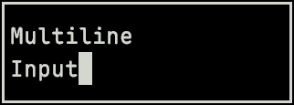

# widget.input 库

`widget.input` 用于设置输入框。

> 输入框由绘制组件和交互组件构成。

---

# 目录

## 常量

| 常量         | 说明           | 定位                      |
| ------------ | -------------- | ------------------------- |
| `SINGLELINE` | 单行输入模式   | [SINGLELINE](#singleline) |
| `MULTILINE`  | 多行输入模式   | [MULTILINE](#multiline)   |
| `BLOCK`      | 方形光标样式   | [BLOCK](#block)           |
| `UNDERLINE`  | 下划线光标样式 | [UNDERLINE](#underline)   |
| `LINE`       | 竖线光标样式   | [LINE](#line)             |

## 方法

| 方法       | 说明                   | 定位                  |
| ---------- | ---------------------- | --------------------- |
| `create`   | 创建一个输入框对象     | [create](#create)     |
| `delete`   | 删除指定输入框         | [delete](#delete)     |
| `clear`    | 删除所有输入框         | [clear](#clear)       |
| `list`     | 获取所有输入框信息     | [list](#list)         |
| `count`    | 返回当前输入框的总数   | [count](#count)       |
| `draw`     | 绘制输入框             | [draw](#draw)         |
| `focus`    | 聚焦于指定输入框       | [focus](#focus)       |
| `blur`     | 所有输入框失焦         | [blur](#blur)         |
| `set`      | 修改输入框的参数       | [set](#set)           |
| `get_info` | 获取输入框的完整信息表 | [get_info](#get_info) |
| `exists`   | 检查输入框是否存在     | [exists](#exists)     |

---

# 常量

## `SINGLELINE`

单行输入模式。

### 调用

```lua
widget.input.SINGLELINE
```

### 可用于

- 参数 `line_mode`

### 示例

```lua
function Init(ctx)
  input = widget.input.create(20, 1, { line_mode = widget.input.SINGLELINE, text = "Singleline Input" })
end

function HandleEvent(event)
  if event.type == "input" then
    debug.print(table.pretty(event))
    if event.data.kind == "submitted" then
      widget.input.blur()
    elseif event.data.kind == "focus_requested" then
      widget.input.focus(input)
    end
  end
end

function Render()
  draw.stroke_rect(4, 1, 22, 3)
  widget.input.draw(input, 5, 2)
end
```

**输出：**


### 等值

```text
"singleline"
```

---

## `MULTILINE`

多行输入模式。

### 调用

```lua
widget.input.MULTILINE
```

### 可用于

- 参数 `line_mode`

### 示例

```lua
function Init(ctx)
  input = widget.input.create(20, 2, { line_mode = widget.input.MULTILINE, text = "Multiline\nInput" })
end

function HandleEvent(event)
  if event.type == "input" then
    debug.print(table.pretty(event))
    if event.data.kind == "submitted" then
      widget.input.blur()
    elseif event.data.kind == "focus_requested" then
      widget.input.focus(input)
    end
  end
end

function Render()
  draw.stroke_rect(4, 1, 22, 4)
  widget.input.draw(input, 5, 2)
end
```

**输出：**



### 等值

```text
"multiline"
```

---

## `BLOCK`

方形光标样式。

### 调用

```lua
widget.input.BLOCK
```

### 可用于

- 参数 `cursor_shape`

### 示例

```lua
function Init(ctx)
  input = widget.input.create(5, 1, { cursor_shape = widget.input.BLOCK, text = "Hi" })
end

function HandleEvent(event)
  if event.type == "input" then
    debug.print(table.pretty(event))
    if event.data.kind == "submitted" then
      widget.input.blur()
    elseif event.data.kind == "focus_requested" then
      widget.input.focus(input)
    end
  end
end

function Render()
  draw.stroke_rect(4, 1, 8, 3)
  widget.input.draw(input, 5, 2)
end
```

**输出：**


### 等值

```text
"█"
```

---

## `UNDERLINE`

下划线光标样式。

### 调用

```lua
widget.input.UNDERLINE
```

### 可用于

- 参数 `cursor_shape`

### 示例

```lua
function Init(ctx)
  input = widget.input.create(5, 1, { cursor_shape = widget.input.LINE, text = "Hi" })
end

function HandleEvent(event)
  if event.type == "input" then
    debug.print(table.pretty(event))
    if event.data.kind == "submitted" then
      widget.input.blur()
    elseif event.data.kind == "focus_requested" then
      widget.input.focus(input)
    end
  end
end

function Render()
  draw.stroke_rect(4, 1, 8, 3)
  widget.input.draw(input, 5, 2)
end
```

**输出：**


### 等值

```text
"_"
```

---

## `LINE`

竖线光标样式。

### 调用

```lua
widget.input.LINE
```

### 可用于

- 参数 `cursor_shape`

### 示例

```lua
function Init(ctx)
  input = widget.input.create(5, 1, { cursor_shape = widget.input.UNDERLINE, text = "Hi" })
end

function HandleEvent(event)
  if event.type == "input" then
    debug.print(table.pretty(event))
    if event.data.kind == "submitted" then
      widget.input.blur()
    elseif event.data.kind == "focus_requested" then
      widget.input.focus(input)
    end
  end
end

function Render()
  draw.stroke_rect(4, 1, 8, 3)
  widget.input.draw(input, 5, 2)
end
```

**输出：**


### 等值

```text
"▏"
```

---

# 方法

## `create`

创建一个输入框对象。

### 调用

```lua
widget.input.create
```

### 参数

#### 必填参数

| 参数名   | 类型    | 说明       |
| -------- | ------- | ---------- |
| `width`  | integer | 输入框宽度 |
| `height` | integer | 输入框高度 |

#### 选填参数

| 参数               | 类型                                 | 默认值                    | 含义                               |
| ------------------ | ------------------------------------ | ------------------------- | ---------------------------------- |
| `fg`               | string / const-color                 | `color.NONE`              | 前景色                             |
| `bg`               | string / const-color                 | `color.NONE`              | 背景色                             |
| `vertical_align`   | const-align                          | `align.AUTO`              | 文本内容垂直对齐方式               |
| `horizontal_align` | const-align                          | `align.AUTO`              | 各行相对于最长显示行的水平对齐方式 |
| `text`             | string                               | `""`                      | 已输入的文本                       |
| `max_chars`        | integer / nil / `false`              | `nil`                     | 最大字符数                         |
| `line_mode`        | const-input                          | `widget.input.SINGLELINE` | 输入模式                           |
| `mouse`            | boolean                              | `true`                   | 是否允许鼠标操作                   |
| `enter_submit`     | boolean                              | 跟随选填参数 `line_mode`  | \[Enter] 提交                      |
| `placeholder`      | string                               | `""`                      | 空内容提示文本                     |
| `placeholder_fg`   | string / const-color                 | `color.NONE`              | 空内容提示文本前景色               |
| `cursor_shape`     | string / const-input / nil / `false` | `widget.input.BLOCK`      | 光标样式                           |
| `cursor_blink`     | boolean                              | `true`                    | 光标是否闪烁                       |
| `bold`             | boolean                              | `false`                   | 粗体                               |
| `italic`           | boolean                              | `false`                   | 斜体                               |
| `underline`        | boolean                              | `false`                   | 下划线                             |
| `strike`           | boolean                              | `false`                   | 删除线                             |
| `blink`            | boolean                              | `false`                   | 闪烁                               |
| `reverse`          | boolean                              | `false`                   | 反显                               |
| `hidden`           | boolean                              | `false`                   | 隐藏                               |
| `dim`              | boolean                              | `false`                   | 暗淡                               |

### 返回值

返回一个值。

| 类型   | 说明      |
| ------ | --------- |
| string | 输入框 ID |

### 示例

```lua
function Init(ctx)
  input = widget.input.create(20, 1)
end

function HandleEvent(event)
  if event.type == "input" then
    debug.print(table.pretty(event))
    if event.data.kind == "submitted" then
      widget.input.blur()
    elseif event.data.kind == "focus_requested" then
      widget.input.focus(input)
    end
  end
end

function Render()
  draw.stroke_rect(4, 1, 22, 3)
  widget.input.draw(input, 5, 2)
end
```

**输出：**


### 额外说明

- 必填参数 `width` 取值范围为 $[1, 65535]$。
- 必填参数 `height` 取值范围为 $[1, 65535]$。
- 选填参数 `max_chars` 取值范围为 $[1, 65535]$。
- 选填参数 `enter_submit` 作用为是否将 `Enter` 作为提交，`true` 表示使用单键 `[Enter]`、组合键 `[LCtrl + Enter]` / `[RCtrl + Enter]` 作为换行；`false` 表示表示使用单键 `[Enter]` 作为换行，组合键 `[LCtrl + Enter]` / `[RCtrl + Enter]` 作为提交。
- 当选填参数 `line_mode` 为 `widget.input.SINGLELINE` 时，选填参数 `enter_submit` 默认为 `true`；当选填参数 `line_mode` 为 `widget.input.MULTILINE` 时，选填参数 `enter_submit` 默认为 `false`。
- 当选填参数 `line_mode` 为 `widget.input.SINGLELINE` 时，换行键会被解析为提交。

---

## `delete`

删除指定输入框。

### 调用

```lua
widget.input.delete
```

### 参数

#### 必填参数

| 参数名 | 类型   | 说明      |
| ------ | ------ | --------- |
| `id`   | string | 输入框 ID |

### 返回值

返回一个值。

| 类型    | 说明         |
| ------- | ------------ |
| boolean | 删除是否成功 |

### 示例

```lua
local input = widget.input.create(20, 10)
debug.print(input)

debug.print(widget.input.delete(input))

debug.print(table.pretty(widget.input.list()))
```

**输出：**

```lua
input_001
true
{
  n = 0
}
```

---

## `clear`

删除所有输入框。

### 调用

```lua
widget.input.clear
```

### 返回值

返回一个值。

| 类型    | 说明         |
| ------- | ------------ |
| boolean | 删除是否成功 |

### 示例

```lua
widget.input.create(20, 10)
widget.input.create(30, 8)
widget.input.create(40, 6)
widget.input.create(50, 4)

debug.print(widget.input.clear())

debug.print(table.pretty(widget.input.list()))
```

**输出：**

```lua
true
{
  n = 0
}
```

---

## `list`

获取所有输入框信息。

### 调用

```lua
widget.input.list
```

### 返回值

返回一个值。

| 类型  | 说明                   |
| ----- | ---------------------- |
| table | 所有输入框信息的混合表 |

### 示例

```lua
local input = widget.input.create(20, 10)

debug.print(table.pretty(widget.input.list()))
```

**输出：**

```lua
{
  [1] = {
    id = "input_001",
    width = 20,
    height = 10,
    fg = "none",
    bg = "none",
    vertical_align = "auto",
    horizontal_align = "auto",
    text = "",
    max_chars = nil,
    line_mode = "singleline",
    mouse = true,
    enter_submit = true,
    placeholder = "",
    placeholder_fg = "none",
    cursor_shape = "█",
    cursor_blink = true,
    bold = false,
    italic = false,
    underline = false,
    strike = false,
    blink = false,
    reverse = false,
    hidden = false,
    dim = false
  },
  n = 1
}
```

### 额外说明

- 返回值混合表结构如下：

```lua
{
  {
    id = "input_001",          -- string（输入框 ID）
    width = 20,                -- integer（输入框宽度）
    height = 10,               -- integer（输入框高度）
    fg = "none",               -- string（前景色）
    bg = "none",               -- string（背景色）
    vertical_align = "auto",   -- string（文本内容垂直对齐方式）
    horizontal_align = "auto", -- string（各行相对于最长显示行的水平对齐方式）
    text = "",                 -- string（已输入的文本）
    max_chars = nil,           -- integer / nil / false（最大字符数）
    line_mode = "singleline",  -- const-input（输入模式）
    mouse = true               -- boolean（是否允许鼠标操作）
    enter_submit = true,       -- boolean（提交按键模式）
    placeholder = "",          -- string（空内容提示文本）
    placeholder_fg = "none",   -- string（空内容提示文本前景色）
    cursor_shape = "█",        -- string / nil / false（光标样式）
    cursor_blink = true,       -- boolean（光标是否闪烁）
    bold = false,              -- boolean（粗体）
    italic = false,            -- boolean（斜体）
    underline = false,         -- boolean（下划线）
    strike = false,            -- boolean（删除线）
    blink = false,             -- boolean（闪烁）
    reverse = false,           -- boolean（反显）
    hidden = false,            -- boolean（隐藏）
    dim = false                -- boolean（暗淡）
  },
  n = 1,                       -- integer（输入框数量）
}
```

---

## `count`

返回当前输入框的总数。

### 调用

```lua
widget.input.count
```

### 返回值

返回一个值。

| 类型    | 说明       |
| ------- | ---------- |
| integer | 输入框总数 |

### 示例

```lua
widget.input.create(20, 10)
widget.input.create(30, 8)

debug.print(widget.input.count())
```

**输出：**

```lua
2
```

---

## `draw`

绘制输入框。

### 调用

```lua
widget.input.draw
```

### 参数

#### 必填参数

| 参数名 | 类型    | 说明                      |
| ------ | ------- | ------------------------- |
| `id`   | string  | 输入框 ID                 |
| `x`    | integer | 输入框左上角位置的 x 坐标 |
| `y`    | integer | 输入框左上角位置的 y 坐标 |

#### 选填参数

| 参数名        | 类型   | 默认值   | 说明             |
| ------------- | ------ | -------- | ---------------- |
| `slice_layer` | string | `"base"` | 绘制目标图层切片 |

### 返回值

无返回值。

### 示例

```lua
function Init(ctx)
  input = widget.input.create(20, 1)
end

function HandleEvent(event)
  if event.type == "input" then
    debug.print(table.pretty(event))
    if event.data.kind == "submitted" then
      widget.input.blur()
    elseif event.data.kind == "focus_requested" then
      widget.input.focus(input)
    end
  end
end

function Render()
  draw.stroke_rect(4, 1, 22, 3)
  widget.input.draw(input, 5, 2)
end
```

**输出：**


### 额外说明

- 必填参数 `x` 取值范围为 $[-2147483648, 2147483647]$。
- 必填参数 `y` 取值范围为 $[-2147483648, 2147483647]$。

---

## `focus`

聚焦于指定输入框。

### 调用

```lua
widget.input.focus
```

### 参数

#### 必填参数

| 参数名 | 类型   | 说明      |
| ------ | ------ | --------- |
| `id`   | string | 输入框 ID |

### 返回值

返回一个值。

| 类型    | 说明         |
| ------- | ------------ |
| boolean | 聚焦是否成功 |

### 示例

```lua
local input = widget.input.create(20, 10)
debug.print(widget.input.focus(input))
```

**输出：**

```lua
true
```

---

## `blur`

所有输入框失焦。

### 调用

```lua
widget.input.blur
```

### 参数

无参数。

### 返回值

返回一个值。

| 类型    | 说明         |
| ------- | ------------ |
| boolean | 失焦是否成功 |

### 示例

```lua

local input = widget.input.create(20, 10)
widget.input.focus(input)
debug.print(widget.input.blur())
```

**输出：**

```lua
true
```

---

## `set`

修改输入框的参数。

### 调用

```lua
widget.input.set
```

### 参数

#### 必填参数

| 参数名 | 类型   | 说明      |
| ------ | ------ | --------- |
| `id`   | string | 输入框 ID |

#### 选填参数

| 参数               | 类型                                 | 默认值   | 含义                               |
| ------------------ | ------------------------------------ | -------- | ---------------------------------- |
| `width`            | integer                              | 保持原值 | 输入框宽度                         |
| `height`           | integer                              | 保持原值 | 输入框高度                         |
| `fg`               | string / const-color                 | 保持原值 | 前景色                             |
| `bg`               | string / const-color                 | 保持原值 | 背景色                             |
| `vertical_align`   | const-align                          | 保持原值 | 文本内容垂直对齐方式               |
| `horizontal_align` | const-align                          | 保持原值 | 各行相对于最长显示行的水平对齐方式 |
| `text`             | string                               | 保持原值 | 已输入的文本                       |
| `max_chars`        | integer / nil / `false`              | 保持原值 | 最大字符数                         |
| `line_mode`        | const-input                          | 保持原值 | 输入模式                           |
| `mouse`            | boolean                              | 保持原值 | 是否允许鼠标操作                   |
| `enter_submit`     | boolean                              | 保持原值 | \[Enter] 提交                      |
| `placeholder`      | string                               | 保持原值 | 空内容提示文本                     |
| `placeholder_fg`   | string / const-color                 | 保持原值 | 空内容提示文本前景色               |
| `cursor_shape`     | string / const-input / nil / `false` | 保持原值 | 光标样式                           |
| `cursor_blink`     | boolean                              | 保持原值 | 光标是否闪烁                       |
| `bold`             | boolean                              | 保持原值 | 粗体                               |
| `italic`           | boolean                              | 保持原值 | 斜体                               |
| `underline`        | boolean                              | 保持原值 | 下划线                             |
| `strike`           | boolean                              | 保持原值 | 删除线                             |
| `blink`            | boolean                              | 保持原值 | 闪烁                               |
| `reverse`          | boolean                              | 保持原值 | 反显                               |
| `hidden`           | boolean                              | 保持原值 | 隐藏                               |
| `dim`              | boolean                              | 保持原值 | 暗淡                               |

### 返回值

返回一个值。

| 类型    | 说明         |
| ------- | ------------ |
| boolean | 修改是否成功 |

### 示例

```lua
local input = widget.input.create(20, 10)

debug.print(widget.input.set(input, { width = 25, height = 5 }))

debug.print(table.pretty(widget.input.get_info(input)))
```

**输出：**

```lua
true
{
  id = "input_001",
  width = 25,
  height = 5,
  fg = "none",
  bg = "none",
  vertical_align = "auto",
  horizontal_align = "auto",
  text = "",
  max_chars = nil,
  line_mode = "singleline",
  mouse = true,
  enter_submit = true,
  placeholder = "",
  placeholder_fg = "none",
  cursor_shape = "█",
  cursor_blink = true,
  bold = false,
  italic = false,
  underline = false,
  strike = false,
  blink = false,
  reverse = false,
  hidden = false,
  dim = false
}
```

### 额外说明

- 选填参数 `width` 取值范围为 $[1, 65535]$。
- 选填参数 `height` 取值范围为 $[1, 65535]$。
- 选填参数 `max_chars` 取值范围为 $[1, 65535]$。

---

## `get_info`

获取输入框的完整信息表。

### 调用

```lua
widget.input.get_info
```

### 参数

#### 必填参数

| 参数名 | 类型   | 说明      |
| ------ | ------ | --------- |
| `id`   | string | 输入框 ID |

### 返回值

**该输入框存在时**，返回一个值。

| 类型  | 说明               |
| ----- | ------------------ |
| table | 该输入框信息对象表 |

**该输入框不存在时**，返回一个值。

| 类型 | 说明           |
| ---- | -------------- |
| nil  | 不存在该输入框 |

### 示例

```lua
local input = widget.input.create(20, 10)

debug.print(table.pretty(widget.input.get_info(input)))
```

**输出：**

```lua
{
  id = "input_001",
  width = 20,
  height = 10,
  fg = "none",
  bg = "none",
  vertical_align = "auto",
  horizontal_align = "auto",
  text = "",
  max_chars = nil,
  line_mode = "singleline",
  mouse = true,
  enter_submit = true,
  placeholder = "",
  placeholder_fg = "none",
  cursor_shape = "█",
  cursor_blink = true,
  bold = false,
  italic = false,
  underline = false,
  strike = false,
  blink = false,
  reverse = false,
  hidden = false,
  dim = false
}
```

### 额外说明

- 返回对象表包含以下字段：

```lua
{
  id = "input_001",          -- string（输入框 ID）
  width = 20,                -- integer（输入框宽度）
  height = 10,               -- integer（输入框高度）
  fg = "none",               -- string（前景色）
  bg = "none",               -- string（背景色）
  vertical_align = "auto",   -- string（文本内容垂直对齐方式）
  horizontal_align = "auto", -- string（各行相对于最长显示行的水平对齐方式）
  text = "",                 -- string（已输入的文本）
  max_chars = nil,           -- integer / nil / false（最大字符数）
  line_mode = "singleline",  -- const-input（输入模式）
  mouse = true               -- boolean（是否允许鼠标操作）
  enter_submit = true,       -- boolean（提交按键模式）
  placeholder = "",          -- string（空内容提示文本）
  placeholder_fg = "none",   -- string（空内容提示文本前景色）
  cursor_shape = "█",        -- string / nil / false（光标样式）
  cursor_blink = true,       -- boolean（光标是否闪烁）
  bold = false,              -- boolean（粗体）
  italic = false,            -- boolean（斜体）
  underline = false,         -- boolean（下划线）
  strike = false,            -- boolean（删除线）
  blink = false,             -- boolean（闪烁）
  reverse = false,           -- boolean（反显）
  hidden = false,            -- boolean（隐藏）
  dim = false                -- boolean（暗淡）
}
```

---

## `exists`

检查输入框是否存在。

### 调用

```lua
widget.input.exists
```

### 参数

#### 必填参数

| 参数名 | 类型   | 说明      |
| ------ | ------ | --------- |
| `id`   | string | 输入框 ID |

### 返回值

返回一个值。

| 类型    | 说明             |
| ------- | ---------------- |
| boolean | 该输入框是否存在 |

### 示例

```lua
local input = widget.input.create(20, 10)
debug.print(widget.input.exists(input))

widget.input.delete(input)
debug.print(widget.input.exists(input))
```

**输出：**

```lua
true
false
```