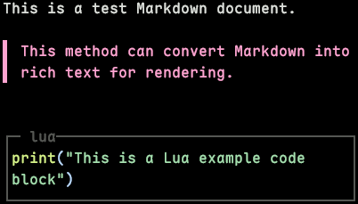

# widget.markdown 库

`widget.markdown` 用于设置 Markdown 文档。

---

# 目录

## 方法

| 方法                    | 说明                             | 定位                  |
| ----------------------- | -------------------------------- | --------------------- |
| `markdown_to_rich_text` | 将 Markdown 文档内容转换为富文本 | [create](#create)     |
| `create`                | 创建一个 Markdown 文档对象       | [create](#create)     |
| `delete`                | 删除指定 Markdown 文档           | [delete](#delete)     |
| `clear`                 | 删除所有 Markdown 文档           | [clear](#clear)       |
| `list`                  | 获取所有 Markdown 文档信息       | [list](#list)         |
| `count`                 | 返回当前 Markdown 文档的总数     | [count](#count)       |
| `draw`                  | 绘制 Markdown 文档               | [draw](#draw)         |
| `scroll`                | 模拟滚动 Markdown 文档           | [click](#click)       |
| `set`                   | 修改 Markdown 文档的参数         | [set](#set)           |
| `get_info`              | 获取 Markdown 文档的完整信息表   | [get_info](#get_info) |
| `exists`                | 检查 Markdown 文档是否存在       | [exists](#exists)     |

---

# 方法

## `markdown_to_rich_text`

将 Markdown 文档内容转换为富文本。

### 调用

```lua
widget.markdown.markdown_to_rich_text
```

### 参数

#### 必填参数

| 参数名     | 类型   | 说明              |
| ---------- | ------ | ----------------- |
| `markdown` | string | Markdown 文档内容 |

#### 选填参数

| 参数    | 类型  | 默认值 | 含义     |
| ------- | ----- | ------ | -------- |
| `theme` | table | `{}`   | 应用主题 |

### 返回值

返回一个值。

| 类型   | 说明               |
| ------ | ------------------ |
| string | 转换后的富文本内容 |

### 示例

````lua
function Init(ctx)
  markdown = widget.markdown.markdown_to_rich_text([[This is a **test Markdown document**.\n\n> This method can convert Markdown into rich text for rendering.\n\n```lua\nprint("This is a Lua example code block")\n```]])
end

function Render()
  widget.markdown.draw(markdown, 5, 2)
end
````

**输出：**

### 额外说明

- 选填参数 `theme` 为无效值或存在无法解析的字段时，自动退回程序内置主题。
- 该方法转换出来的富文本仅具有展示作用，链接等内容无实用交互。

---

## `create`

创建一个 Markdown 文档对象。

### 调用

```lua
widget.markdown.create
```

### 参数

#### 必填参数

| 参数名     | 类型    | 说明              |
| ---------- | ------- | ----------------- |
| `width`    | integer | Markdown 文档宽度 |
| `height`   | integer | Markdown 文档高度 |
| `markdown` | string  | Markdown 文档内容 |

#### 选填参数

| 参数                    | 类型                     | 默认值 | 含义     |
| ----------------------- | ------------------------ | ------ | -------- |
| `theme`                 | table                    | `{}`   | 应用主题 |
| `vertical_scroll_shape` | string / const-scrollbox | ``     | 应用主题 |

### 返回值

返回一个值。

| 类型   | 说明             |
| ------ | ---------------- |
| string | Markdown 文档 ID |

### 示例

````lua
function Init(ctx)
  markdown = widget.markdown.create(40, 5,[[This is a **test Markdown document**.\n\n> This method can convert Markdown into rich text for rendering.\n\n```lua\nprint("This is a Lua example code block")\n```]])
end

function Render()
  widget.markdown.draw(markdown, 5, 2)
end
````

**输出：**

### 额外说明

- 必填参数 `markdown` 在填写文件路径时，路径相对当前包的 `assets/`。

---

## `delete`

删除指定 Markdown 文档。

### 调用

```lua
widget.markdown.delete
```

### 参数

#### 必填参数

| 参数名 | 类型   | 说明             |
| ------ | ------ | ---------------- |
| `id`   | string | Markdown 文档 ID |

### 返回值

返回一个值。

| 类型    | 说明         |
| ------- | ------------ |
| boolean | 删除是否成功 |

### 示例

```lua
local markdown = widget.markdown.create("test", "./test.md")
debug.print(markdown)

debug.print(widget.markdown.delete(markdown))

debug.print(table.pretty(widget.markdown.list()))
```

**输出：**

```lua
markdown_001
true
{
  n = 0
}
```

---

## `clear`

删除所有 Markdown 文档。

### 调用

```lua
widget.markdown.clear
```

### 返回值

返回一个值。

| 类型    | 说明         |
| ------- | ------------ |
| boolean | 删除是否成功 |

### 示例

```lua
widget.markdown.create("test", "./test.md")
widget.markdown.create("test", "./test.md")
widget.markdown.create("test", "./test.md")
widget.markdown.create("test", "./test.md")

debug.print(widget.markdown.clear())

debug.print(table.pretty(widget.markdown.list()))
```

**输出：**

```lua
true
{
  n = 0
}
```

---

## `list`

获取所有 Markdown 文档信息。

### 调用

```lua
widget.markdown.list
```

### 返回值

返回一个值。

| 类型  | 说明                           |
| ----- | ------------------------------ |
| table | 所有 Markdown 文档信息的混合表 |

### 示例

```lua
local markdown = widget.markdown.create("test", "./test.md")

debug.print(table.pretty(widget.markdown.list()))
```

**输出：**

```lua
{
  [1] = {
    id = "markdown_001",
    text = "test",
    markdown = "./test.md",
    fg = "bright_blue",
    bg = "none",
    hover_fg = "bright_blue",
    hover_bg = "none",
    copy = false,
    bold = false,
    italic = false,
    underline = false,
    strike = false,
    bmarkdown = false,
    reverse = false,
    hidden = false,
    dim = false
  },
  n = 1
}
```

### 额外说明

- 返回值混合表结构如下：

```lua
{
  {
    id = "markdown_001",          -- string（ Markdown 文档 ID）
    text = "test",            -- string（链接展示文本）
    markdown = "./test.md",       -- string（链接目标）
    fg = "bright_blue",       -- string（前景色）
    bg = "none",              -- string（背景色）
    hover_fg = "bright_blue", -- string（指针悬浮前景色）
    hover_bg = "none",        -- string（指针悬浮背景色）
    copy = false,             -- boolean（执行后是否复制到剪切板）
    bold = false,             -- boolean（粗体）
    italic = false,           -- boolean（斜体）
    underline = false,        -- boolean（下划线）
    strike = false,           -- boolean（删除线）
    bmarkdown = false,            -- boolean（闪烁）
    reverse = false,          -- boolean（反显）
    hidden = false,           -- boolean（隐藏）
    dim = false               -- boolean（暗淡）
  },
  n = 1,                      -- integer（ Markdown 文档数量）
}
```

---

## `count`

返回当前 Markdown 文档的总数。

### 调用

```lua
widget.markdown.count
```

### 返回值

返回一个值。

| 类型    | 说明              |
| ------- | ----------------- |
| integer | Markdown 文档总数 |

### 示例

```lua
widget.markdown.create("test", "./test.md")
widget.markdown.create("test", "./test.md")

debug.print(widget.markdown.count())
```

**输出：**

```lua
2
```

---

## `draw`

绘制 Markdown 文档。

### 调用

```lua
widget.markdown.draw
```

### 参数

#### 必填参数

| 参数名 | 类型    | 说明                             |
| ------ | ------- | -------------------------------- |
| `id`   | string  | Markdown 文档 ID                 |
| `x`    | integer | Markdown 文档左上角位置的 x 坐标 |
| `y`    | integer | Markdown 文档左上角位置的 y 坐标 |

#### 选填参数

| 参数名        | 类型   | 默认值   | 说明             |
| ------------- | ------ | -------- | ---------------- |
| `slice_layer` | string | `"base"` | 绘制目标图层切片 |

### 返回值

无返回值。

### 示例

```lua
function Init(ctx)
  markdown = widget.markdown.create("Tui Game", "https://github.com/MXBraisedFish/tui-game")
end

function Render()
  widget.markdown.draw(markdown, 5, 2)
end
```

**输出：**



### 额外说明

- 必填参数 `x` 取值范围为 $[-2147483648, 2147483647]$。
- 必填参数 `y` 取值范围为 $[-2147483648, 2147483647]$。

---

## `click`

模拟点击 Markdown 文档。

### 调用

```lua
widget.markdown.click
```

### 参数

#### 必填参数

| 参数名 | 类型   | 说明             |
| ------ | ------ | ---------------- |
| `id`   | string | Markdown 文档 ID |

### 返回值

返回一个值。

| 类型    | 说明         |
| ------- | ------------ |
| boolean | 聚焦是否成功 |

### 示例

```lua
local markdown = widget.markdown.create("Tui Game", "https://github.com/MXBraisedFish/tui-game", { copy = true })
debug.print(widget.markdown.click(markdown))
```

**输出：**

```lua
true
```

---

## `set`

修改 Markdown 文档的参数。

### 调用

```lua
widget.markdown.set
```

### 参数

#### 必填参数

| 参数名 | 类型   | 说明             |
| ------ | ------ | ---------------- |
| `id`   | string | Markdown 文档 ID |

#### 选填参数

| 参数        | 类型                 | 默认值   | 含义                   |
| ----------- | -------------------- | -------- | ---------------------- |
| `text`      | string               | 保持原值 | 链接展示文本           |
| `markdown`  | string               | 保持原值 | 链接目标               |
| `fg`        | string / const-color | 保持原值 | 前景色                 |
| `bg`        | string / const-color | 保持原值 | 背景色                 |
| `hover_fg`  | string / const-color | 保持原值 | 指针悬浮前景色         |
| `hover_bg`  | string / const-color | 保持原值 | 指针悬浮背景色         |
| `copy`      | boolean              | 保持原值 | 执行后是否复制到剪切板 |
| `bold`      | boolean              | 保持原值 | 粗体                   |
| `italic`    | boolean              | 保持原值 | 斜体                   |
| `underline` | boolean              | 保持原值 | 下划线                 |
| `strike`    | boolean              | 保持原值 | 删除线                 |
| `bmarkdown` | boolean              | 保持原值 | 闪烁                   |
| `reverse`   | boolean              | 保持原值 | 反显                   |
| `hidden`    | boolean              | 保持原值 | 隐藏                   |
| `dim`       | boolean              | 保持原值 | 暗淡                   |

### 返回值

返回一个值。

| 类型    | 说明         |
| ------- | ------------ |
| boolean | 修改是否成功 |

### 示例

```lua
local markdown = widget.markdown.create("test", "./test.md")

debug.print(widget.markdown.set(markdown, { fg = color.BRIGHT_GREEN, hover_fg = color.BRIGHT_RED }))

debug.print(table.pretty(widget.markdown.get_info(markdown)))
```

**输出：**

```lua
true
{
  id = "markdown_001",
  text = "test",
  markdown = "./test.md",
  fg = "bright_green",
  bg = "none",
  hover_fg = "bright_red",
  hover_bg = "none",
  copy = false,
  bold = false,
  italic = false,
  underline = false,
  strike = false,
  bmarkdown = false,
  reverse = false,
  hidden = false,
  dim = false
}
```

### 额外说明

- 必填参数 `width` 取值范围为 $[1, 65535]$。
- 必填参数 `height` 取值范围为 $[1, 65535]$。
- 选填参数 `max_chars` 取值范围为 $[1, 65535]$。

---

## `get_info`

获取 Markdown 文档的完整信息表。

### 调用

```lua
widget.markdown.get_info
```

### 参数

#### 必填参数

| 参数名 | 类型   | 说明             |
| ------ | ------ | ---------------- |
| `id`   | string | Markdown 文档 ID |

### 返回值

**该 Markdown 文档存在时**，返回一个值。

| 类型  | 说明                       |
| ----- | -------------------------- |
| table | 该 Markdown 文档信息对象表 |

**该 Markdown 文档不存在时**，返回一个值。

| 类型 | 说明                   |
| ---- | ---------------------- |
| nil  | 不存在该 Markdown 文档 |

### 示例

```lua
local markdown = widget.markdown.create("test", "./test.md")

debug.print(table.pretty(widget.markdown.get_info(markdown)))
```

**输出：**

```lua
{
  id = "markdown_001",
  width = 20,
  height = 10,
  fg = "none",
  bg = "none",
  vertical_align = "auto",
  horizontal_align = "auto",
  text = "",
  max_chars = nil,
  line_mode = "singleline",
  mouse = false,
  enter_submit = true,
  placeholder = "",
  placeholder_fg = "none",
  cursor_shape = "█",
  cursor_bmarkdown = true,
  bold = false,
  italic = false,
  underline = false,
  strike = false,
  bmarkdown = false,
  reverse = false,
  hidden = false,
  dim = false
}
```

### 额外说明

- 返回对象表包含以下字段：

```lua
{
  id = "markdown_001",          -- string（ Markdown 文档 ID）
  text = "test",            -- string（链接展示文本）
  markdown = "./test.md",       -- string（链接目标）
  fg = "bright_blue",       -- string（前景色）
  bg = "none",              -- string（背景色）
  hover_fg = "bright_blue", -- string（指针悬浮前景色）
  hover_bg = "none",        -- string（指针悬浮背景色）
  copy = false,             -- boolean（执行后是否复制到剪切板）
  bold = false,             -- boolean（粗体）
  italic = false,           -- boolean（斜体）
  underline = false,        -- boolean（下划线）
  strike = false,           -- boolean（删除线）
  bmarkdown = false,            -- boolean（闪烁）
  reverse = false,          -- boolean（反显）
  hidden = false,           -- boolean（隐藏）
  dim = false               -- boolean（暗淡）
}
```

---

## `exists`

检查 Markdown 文档是否存在。

### 调用

```lua
widget.markdown.exists
```

### 参数

#### 必填参数

| 参数名 | 类型   | 说明             |
| ------ | ------ | ---------------- |
| `id`   | string | Markdown 文档 ID |

### 返回值

返回一个值。

| 类型    | 说明                     |
| ------- | ------------------------ |
| boolean | 该 Markdown 文档是否存在 |

### 示例

```lua
local markdown = widget.markdown.create("test", "./test.md")
debug.print(widget.markdown.exists(markdown))

widget.markdown.delete(markdown)
debug.print(widget.markdown.exists(markdown))
```

**输出：**

```lua
true
false
```
