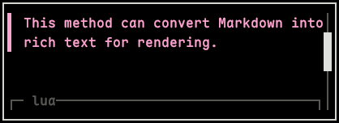

# widget.markdown 库

`widget.markdown` 用于设置 Markdown 文档。

> Markdown 文档组件由绘制组件、交互组件和切片图层组件构成。

---

# 目录

## 方法

| 方法                    | 说明                             | 定位                                            |
| ----------------------- | -------------------------------- | ----------------------------------------------- |
| `markdown_to_rich_text` | 将 Markdown 文档内容转换为富文本 | [markdown_to_rich_text](#markdown_to_rich_text) |
| `create`                | 创建一个 Markdown 文档对象       | [create](#create)                               |
| `delete`                | 删除指定 Markdown 文档           | [delete](#delete)                               |
| `clear`                 | 删除所有 Markdown 文档           | [clear](#clear)                                 |
| `list`                  | 获取所有 Markdown 文档信息       | [list](#list)                                   |
| `count`                 | 返回当前 Markdown 文档的总数     | [count](#count)                                 |
| `draw`                  | 绘制 Markdown 文档               | [draw](#draw)                                   |
| `scroll`                | 模拟滚动 Markdown 文档           | [scroll](#scroll)                               |
| `set`                   | 修改 Markdown 文档的参数         | [set](#set)                                     |
| `get_info`              | 获取 Markdown 文档的完整信息表   | [get_info](#get_info)                           |
| `exists`                | 检查 Markdown 文档是否存在       | [exists](#exists)                               |

---

# 方法

## `markdown_to_rich_text`

将 Markdown 文档内容转换为富文本。

### 调用

```lua
widget.markdown.markdown_to_rich_text
```

### 参数

#### 必填参数

| 参数名     | 类型   | 说明              |
| ---------- | ------ | ----------------- |
| `markdown` | string | Markdown 文档内容 |

### 返回值

返回一个值。

| 类型   | 说明               |
| ------ | ------------------ |
| string | 转换后的富文本内容 |

### 示例

````lua
local markdown = widget.markdown.markdown_to_rich_text([[This is a **test Markdown document**.

> This method can convert Markdown into rich text for rendering.

```lua
print("This is a Lua example code block")
```]])
debug.print(markdown)
````

**输出：**

```lua
f%<reset><fg:#DCDFDA>This is a <reset><fg:#DCDFDA><bold>test Markdown document<reset><fg:#DCDFDA>.

<reset><fg:#FFA4D1>▌ <reset><fg:#FFA4D1>This method can convert Markdown into rich text for rendering.


<reset><fg:#D5F288>print<reset><fg:#B8D7F9>(<reset><fg:#A4DFAE>"This is a Lua example code block"<reset><fg:#B8D7F9>)

<reset>
```

### 额外说明

- 该方法转换出来的富文本仅具有展示作用，链接、代办事项等内容无实用交互。

---

## `create`

创建一个 Markdown 文档对象。

### 调用

```lua
widget.markdown.create
```

### 参数

#### 必填参数

| 参数名     | 类型    | 说明              |
| ---------- | ------- | ----------------- |
| `width`    | integer | Markdown 文档宽度 |
| `height`   | integer | Markdown 文档高度 |
| `markdown` | string  | Markdown 文档内容 |

#### 选填参数

| 参数                    | 类型    | 默认值  | 含义                                 |
| ----------------------- | ------- | ------- | ------------------------------------ |
| `wheel_step_vertical`   | integer | `2`     | 垂直滚动步长                         |
| `wheel_step_horizontal` | integer | `3`     | 水平滚动步长                         |
| `allow_overflow`        | boolean | `false` | 是否允许超宽内容保持原行宽并横向滚动 |

### 返回值

返回一个值。

| 类型   | 说明             |
| ------ | ---------------- |
| string | Markdown 文档 ID |

### 示例

````lua
function Init(ctx)
  markdown = widget.markdown.create(40, 15, [[This is a **test Markdown document**.

> This method can convert Markdown into rich text for rendering.

```lua
print("This is a Lua example code block")
```]])
end

function Render()
  widget.markdown.draw(markdown, 5, 2)
end
````

**输出：**


### 额外说明

- 必填参数 `markdown` 中的链接内容在填写路径时，文件路径起始位置相对当前包的 `assets/`。
- 选填参数 `wheel_step_vertical` 取值范围为 $[1, 65535]$。
- 选填参数 `wheel_step_horizontal` 取值范围为 $[1, 65535]$。
- 选填参数 `wheel_step_horizontal` 仅在选填参数 `allow_overflow` 为 `true` 时生效。

---

## `delete`

删除指定 Markdown 文档。

### 调用

```lua
widget.markdown.delete
```

### 参数

#### 必填参数

| 参数名 | 类型   | 说明             |
| ------ | ------ | ---------------- |
| `id`   | string | Markdown 文档 ID |

### 返回值

返回一个值。

| 类型    | 说明         |
| ------- | ------------ |
| boolean | 删除是否成功 |

### 示例

```lua
local markdown = widget.markdown.create(40, 15, "Test")
debug.print(markdown)

debug.print(widget.markdown.delete(markdown))

debug.print(table.pretty(widget.markdown.list()))
```

**输出：**

```lua
markdown_001
true
{
  n = 0
}
```

---

## `clear`

删除所有 Markdown 文档。

### 调用

```lua
widget.markdown.clear
```

### 返回值

返回一个值。

| 类型    | 说明         |
| ------- | ------------ |
| boolean | 删除是否成功 |

### 示例

```lua
widget.markdown.create(40, 15, "Test")
widget.markdown.create(40, 15, "Test")
widget.markdown.create(40, 15, "Test")
widget.markdown.create(40, 15, "Test")

debug.print(widget.markdown.clear())

debug.print(table.pretty(widget.markdown.list()))
```

**输出：**

```lua
true
{
  n = 0
}
```

---

## `list`

获取所有 Markdown 文档信息。

### 调用

```lua
widget.markdown.list
```

### 返回值

返回一个值。

| 类型  | 说明                           |
| ----- | ------------------------------ |
| table | 所有 Markdown 文档信息的混合表 |

### 示例

```lua
local markdown = widget.markdown.create(40, 15, "Test")

debug.print(table.pretty(widget.markdown.list()))
```

**输出：**

```lua
{
  [1] = {
    id = "markdown_001",
    width = 40,
    height = 15,
    markdown = "Test",
    allow_overflow = false,
    wheel_step_vertical = 2,
    wheel_step_horizontal = 3,
    scroll_offset_vertical = 0,
    scroll_offset_horizontal = 0,
  },
  n = 1
}
```

### 额外说明

- 返回值混合表结构如下：

```lua
{
  {
    id = "markdown_001",          -- string（Markdown 文档 ID）
    width = 40,                   -- integer（Markdown 文档宽度）
    height = 15,                  -- integer（Markdown 文档高度）
    markdown = "Test",            -- string（Markdown 文档内容）
    allow_overflow = false,       -- boolean（是否允许超宽内容保持原行宽并横向滚动）
    wheel_step_vertical = 2,      -- integer（垂直滚动步长）
    wheel_step_horizontal = 3,    -- integer（水平滚动步长）
    scroll_offset_vertical = 0,   -- integer（垂直已滚动距离）
    scroll_offset_horizontal = 0, -- integer（水平已滚动距离）
  },
  n = 1,                          -- integer（ Markdown 文档数量）
}
```

---

## `count`

返回当前 Markdown 文档的总数。

### 调用

```lua
widget.markdown.count
```

### 返回值

返回一个值。

| 类型    | 说明              |
| ------- | ----------------- |
| integer | Markdown 文档总数 |

### 示例

```lua
widget.markdown.create(40, 15, "Test")
widget.markdown.create(40, 15, "Test")

debug.print(widget.markdown.count())
```

**输出：**

```lua
2
```

---

## `draw`

绘制 Markdown 文档。

### 调用

```lua
widget.markdown.draw
```

### 参数

#### 必填参数

| 参数名 | 类型    | 说明                             |
| ------ | ------- | -------------------------------- |
| `id`   | string  | Markdown 文档 ID                 |
| `x`    | integer | Markdown 文档左上角位置的 x 坐标 |
| `y`    | integer | Markdown 文档左上角位置的 y 坐标 |

#### 选填参数

| 参数名        | 类型   | 默认值   | 说明             |
| ------------- | ------ | -------- | ---------------- |
| `slice_layer` | string | `"base"` | 绘制目标图层切片 |

### 返回值

无返回值。

### 示例

````lua
function Init(ctx)
  markdown = widget.markdown.create(40, 15, [[This is a **test Markdown document**.

> This method can convert Markdown into rich text for rendering.

```lua
print("This is a Lua example code block")
```]])
end

function Render()
  widget.markdown.draw(markdown, 5, 2)
end
````

**输出：**


### 额外说明

- 必填参数 `x` 取值范围为 $[-2147483648, 2147483647]$。
- 必填参数 `y` 取值范围为 $[-2147483648, 2147483647]$。

---

## `scroll`

模拟滚动 Markdown 文档。

### 调用

```lua
widget.markdown.scroll
```

### 参数

#### 必填参数

| 参数名                  | 类型                      | 说明             |
| ----------------------- | ------------------------- | ---------------- |
| `id`                    | string                    | Markdown 文档 ID |
| `scroll_times_vertical` | integer / const-scrollbox | 垂直滚动次数     |

#### 选填参数

| 参数名                    | 类型                      | 默认值 | 说明         |
| ------------------------- | ------------------------- | ------ | ------------ |
| `scroll_times_horizontal` | integer / const-scrollbox | `0`    | 水平滚动次数 |

### 返回值

返回一个值。

| 类型    | 说明                     |
| ------- | ------------------------ |
| boolean | 对象存在且滚动请求已受理 |

### 示例

````lua
local markdown_draw = false
local scroll = false

function Init(ctx)
  markdown = widget.markdown.create(40, 5, [[This is a **test Markdown document**.

> This method can convert Markdown into rich text for rendering.

```lua
print("This is a Lua example code block")
```]])
end

function Update(event)
  if markdown_draw and not scroll then
    widget.markdown.scroll(markdown, 1)

    scroll = true
  end
end

function Render()
  draw.stroke_rect(4, 1, 42, 7)
  widget.markdown.draw(markdown, 5, 2)

  markdown_draw = true
end
````

**输出：**



### 额外说明

- 必填参数 `scroll_times_vertical` 取值范围为 $[-2147483648, 2147483647]$。
- 选填参数 `scroll_times_horizontal` 取值范围为 $[-2147483648, 2147483647]$。
- 选填参数 `scroll_times_horizontal` 仅在当前 Markdown 文档对象的配置字段 `allow_overflow` 为 `true` 时生效。

---

## `set`

修改 Markdown 文档的参数。

### 调用

```lua
widget.markdown.set
```

### 参数

#### 必填参数

| 参数名 | 类型   | 说明             |
| ------ | ------ | ---------------- |
| `id`   | string | Markdown 文档 ID |

#### 选填参数

| 参数                       | 类型                      | 默认值   | 含义                                 |
| -------------------------- | ------------------------- | -------- | ------------------------------------ |
| `width`                    | integer                   | 保持原值 | Markdown 文档宽度                    |
| `height`                   | integer                   | 保持原值 | Markdown 文档高度                    |
| `markdown`                 | string                    | 保持原值 | Markdown 文档内容                    |
| `wheel_step_vertical`      | integer                   | 保持原值 | 垂直滚动步长                         |
| `wheel_step_horizontal`    | integer                   | 保持原值 | 水平滚动步长                         |
| `scroll_offset_vertical`   | integer / const-scrollbox | 保持原值 | 垂直绝对偏移                         |
| `scroll_offset_horizontal` | integer / const-scrollbox | 保持原值 | 水平绝对偏移                         |
| `allow_overflow`           | boolean                   | 保持原值 | 是否允许超宽内容保持原行宽并横向滚动 |

### 返回值

返回一个值。

| 类型    | 说明         |
| ------- | ------------ |
| boolean | 修改是否成功 |

### 示例

```lua
local markdown = widget.markdown.create(40, 15, "Test")

debug.print(widget.markdown.set(markdown, { width = 20, height = 10 }))

debug.print(table.pretty(widget.markdown.get_info(markdown)))
```

**输出：**

```lua
true
{
  id = "markdown_001",
  width = 20,
  height = 10,
  markdown = "Test",
  allow_overflow = false,
  wheel_step_vertical = 2,
  wheel_step_horizontal = 3,
  scroll_offset_vertical = 0,
  scroll_offset_horizontal = 0,
}
```

### 额外说明

- 选填参数 `width` 取值范围为 $[1, 65535]$。
- 选填参数 `height` 取值范围为 $[1, 65535]$。
- 选填参数 `wheel_step_vertical` 取值范围为 $[1, 65535]$。
- 选填参数 `wheel_step_horizontal` 取值范围为 $[1, 65535]$。
- 选填参数 `scroll_offset_vertical` 取值范围为 $[0, n]$；`n` 为滚动框内的内容总高度，超出范围会修正回正常区域。
- 选填参数 `scroll_offset_horizontal` 取值范围为 $[0, n]$；`n` 为滚动框内的内容总高度，超出范围会修正回正常区域。
- 选填参数 `wheel_step_horizontal`、选填参数 `scroll_offset_horizontal` 仅在选填参数 `allow_overflow` 为 `true` 时生效。

---

## `get_info`

获取 Markdown 文档的完整信息表。

### 调用

```lua
widget.markdown.get_info
```

### 参数

#### 必填参数

| 参数名 | 类型   | 说明             |
| ------ | ------ | ---------------- |
| `id`   | string | Markdown 文档 ID |

### 返回值

**该 Markdown 文档存在时**，返回一个值。

| 类型  | 说明                       |
| ----- | -------------------------- |
| table | 该 Markdown 文档信息对象表 |

**该 Markdown 文档不存在时**，返回一个值。

| 类型 | 说明                   |
| ---- | ---------------------- |
| nil  | 不存在该 Markdown 文档 |

### 示例

```lua
local markdown = widget.markdown.create(40, 15, "Test")

debug.print(table.pretty(widget.markdown.get_info(markdown)))
```

**输出：**

```lua
{
  id = "markdown_001",
  width = 40,
  height = 5,
  markdown = "Test",
  allow_overflow = false,
  wheel_step_vertical = 2,
  wheel_step_horizontal = 3,
  scroll_offset_vertical = 0,
  scroll_offset_horizontal = 0,
}
```

### 额外说明

- 返回对象表包含以下字段：

```lua
{
  id = "markdown_001",          -- string（Markdown 文档 ID）
  width = 40,                   -- integer（Markdown 文档宽度）
  height = 5,                   -- integer（Markdown 文档高度）
  markdown = "Test",            -- string（Markdown 文档内容）
  allow_overflow = false,       -- boolean（是否允许超宽内容保持原行宽并横向滚动）
  wheel_step_vertical = 2,      -- integer（垂直滚动步长）
  wheel_step_horizontal = 3,    -- integer（水平滚动步长）
  scroll_offset_vertical = 0,   -- integer（垂直已滚动距离）
  scroll_offset_horizontal = 0, -- integer（水平已滚动距离）
}
```

---

## `exists`

检查 Markdown 文档是否存在。

### 调用

```lua
widget.markdown.exists
```

### 参数

#### 必填参数

| 参数名 | 类型   | 说明             |
| ------ | ------ | ---------------- |
| `id`   | string | Markdown 文档 ID |

### 返回值

返回一个值。

| 类型    | 说明                     |
| ------- | ------------------------ |
| boolean | 该 Markdown 文档是否存在 |

### 示例

```lua
local markdown = widget.markdown.create(40, 15, "Test")
debug.print(widget.markdown.exists(markdown))

widget.markdown.delete(markdown)
debug.print(widget.markdown.exists(markdown))
```

**输出：**

```lua
true
false
```
