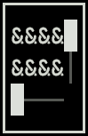
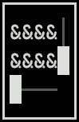
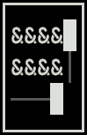
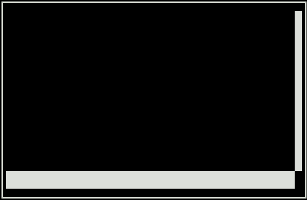

# widget.scrollbox 库

`widget.scrollbox` 用于设置滚动框。

---

# 目录

## 常量

| 常量        | 说明             | 定位                      |
| ----------- | ---------------- | ------------------------- |
| `TO_TOP`    | 垂直滚动到顶部   | [TO_TOP](#to_top)         |
| `TO_BOTTOM` | 垂直滚动到底部   | [TO_BOTTOM](#to_bottom)   |
| `TO_LEFT`   | 水平滚动到最左侧 | [TO_LEFT](#to_left)       |
| `TO_RIGHT`  | 水平滚动到最右侧 | [TO_RIGHT](#to_right)     |

## 方法

| 方法       | 说明                   | 定位                  |
| ---------- | ---------------------- | --------------------- |
| `create`   | 创建一个滚动框对象     | [create](#create)     |
| `delete`   | 删除指定滚动框         | [delete](#delete)     |
| `clear`    | 删除所有滚动框         | [clear](#clear)       |
| `list`     | 获取所有滚动框信息     | [list](#list)         |
| `count`    | 返回当前滚动框的总数   | [count](#count)       |
| `draw`     | 绘制滚动框             | [draw](#draw)         |
| `scroll`   | 模拟滚动滚动框         | [scroll](#scroll)     |
| `set`      | 修改滚动框的参数       | [set](#set)           |
| `get_info` | 获取滚动框的完整信息表 | [get_info](#get_info) |
| `exists`   | 检查滚动框是否存在     | [exists](#exists)     |

---

# 常量

## `TO_TOP`

垂直滚动到顶部。

### 调用

```lua
widget.input.TO_TOP
```

### 可用于

- 参数 `scroll_times_vertical`
- 参数 `scroll_offset_vertical`

### 示例

```lua
local scrollbox_draw = false
local scroll = false

function Init(ctx)
  scrollbox = widget.scrollbox.create(5, 3, { always_show_scrollbar = true })
end

function HandleEvent(event)
  if scrollbox_draw and not scroll then
    widget.scrollbox.scroll(scrollbox, widget.input.TO_TOP, 0)
  end
end

function Render()
  draw.stroke_rect(4, 1, 7, 5)
  draw.fill_rect(0, 0, 20, 8, { char = "&", slice_layer = scrollbox })
  widget.scrollbox.draw(scrollbox, 5, 2)

  scrollbox_draw = true
end
```

**输出：**



### 等值

```text
"to_top"
```

---

## `TO_BOTTOM`

垂直滚动到底部。

### 调用

```lua
widget.input.TO_BOTTOM
```

### 可用于

- 参数 `scroll_times_vertical`
- 参数 `scroll_offset_vertical`

### 示例

```lua
local scrollbox_draw = false
local scroll = false

function Init(ctx)
  scrollbox = widget.scrollbox.create(5, 3, { always_show_scrollbar = true })
end

function HandleEvent(event)
  if scrollbox_draw and not scroll then
    widget.scrollbox.scroll(scrollbox, widget.input.TO_BOTTOM, 0)
  end
end

function Render()
  draw.stroke_rect(4, 1, 7, 5)
  draw.fill_rect(0, 0, 20, 8, { char = "&", slice_layer = scrollbox })
  widget.scrollbox.draw(scrollbox, 5, 2)

  scrollbox_draw = true
end
```

**输出：**



### 等值

```text
"to_bottom"
```

---

## `TO_LEFT`

水平滚动到最左侧。

### 调用

```lua
widget.input.TO_LEFT
```

### 可用于

- 参数 `scroll_times_horizontal`
- 参数 `scroll_offset_horizontal`

### 示例

```lua
local scrollbox_draw = false
local scroll = false

function Init(ctx)
  scrollbox = widget.scrollbox.create(5, 3, { always_show_scrollbar = true })
end

function HandleEvent(event)
  if scrollbox_draw and not scroll then
    widget.scrollbox.scroll(scrollbox, 0, widget.input.TO_LEFT)
  end
end

function Render()
  draw.stroke_rect(4, 1, 7, 5)
  draw.fill_rect(0, 0, 20, 8, { char = "&", slice_layer = scrollbox })
  widget.scrollbox.draw(scrollbox, 5, 2)

  scrollbox_draw = true
end
```

**输出：**


### 等值

```text
"to_left"
```

---

## `TO_RIGHT`

水平滚动到最右侧。

### 调用

```lua
widget.input.TO_RIGHT
```

### 可用于

- 参数 `scroll_times_horizontal`
- 参数 `scroll_offset_horizontal`

### 示例

```lua
local scrollbox_draw = false
local scroll = false

function Init(ctx)
  scrollbox = widget.scrollbox.create(5, 3, { always_show_scrollbar = true })
end

function HandleEvent(event)
  if scrollbox_draw and not scroll then
    widget.scrollbox.scroll(scrollbox, 0, widget.input.TO_RIGHT)
  end
end

function Render()
  draw.stroke_rect(4, 1, 7, 5)
  draw.fill_rect(0, 0, 20, 8, { char = "&", slice_layer = scrollbox })
  widget.scrollbox.draw(scrollbox, 5, 2)

  scrollbox_draw = true
end
```

**输出：**



### 等值

```text
"to_right"
```

---

# 方法

## `create`

创建一个滚动框对象。

### 调用

```lua
widget.scrollbox.create
```

### 参数

#### 必填参数

| 参数名   | 类型    | 说明       |
| -------- | ------- | ---------- |
| `width`  | integer | 滚动框宽度 |
| `height` | integer | 滚动框高度 |

#### 选填参数

| 参数                        | 类型                 | 默认值       | 含义                                 |
| --------------------------- | -------------------- | ------------ | ------------------------------------ |
| `bg`                        | string / const-color | `color.NONE` | 滚动框背景颜色                       |
| `mouse`                     | boolean              | `true`       | 是否允许鼠标操作                     |
| `wheel_vertical`            | boolean              | `true`       | 存在垂直内容超出时，是否可以垂直滚动 |
| `wheel_horizontal`          | boolean              | `true`       | 存在水平内容超出时，是否可以水平滚动 |
| `scrollbar_swap_vertical`   | boolean              | `false`      | 对调垂直滚动条位置                   |
| `scrollbar_swap_horizontal` | boolean              | `false`      | 对调水平滚动条位置                   |
| `track_shape_vertical`      | string               | `│`          | 垂直滚动条轨道样式                   |
| `thumb_shape_vertical`      | string               | `█`          | 垂直滚动条滑块样式                   |
| `track_shape_horizontal`    | string               | `─`          | 水平滚动条轨道样式                   |
| `thumb_shape_horizontal`    | string               | `█`          | 水平滚动条滑块样式                   |
| `include_scrollbar`         | boolean              | `true`       | 滚动框尺寸设置是否将滚动条包含在内   |
| `always_show_scrollbar`     | boolean              | `false`      | 滚动条是否常驻显示                   |
| `wheel_step_vertical`       | integer              | `2`          | 垂直滚动步长                         |
| `wheel_step_horizontal`     | integer              | `3`          | 水平滚动步长                         |

### 返回值

返回一个值。

| 类型   | 说明              |
| ------ | ----------------- |
| string | 滚动框图层切片 ID |

### 示例

```lua
function Init(ctx)
  scrollbox = widget.scrollbox.create(40, 10, { always_show_scrollbar = true })
end

function Render()
  draw.stroke_rect(4, 1, 42, 12)
  widget.scrollbox.draw(scrollbox, 5, 2)
end
```

**输出：**

### 额外说明

- 必填参数 `width` 取值范围为 $[1, 65535]$。
- 必填参数 `height` 取值范围为 $[1, 65535]$。
- 必填参数 `wheel_step_vertical` 取值范围为 $[1, 65535]$。
- 必填参数 `wheel_step_horizontal` 取值范围为 $[1, 65535]$。
- 选填参数 `track_shape_vertical`，选填参数 `thumb_shape_vertical`，选填参数 `track_shape_horizontal` 和选填参数 `thumb_shape_horizontal` 填写时每个字段必须为宽度为 `1` 的字符。
- 选填参数 `include_scrollbar` 仅对当前方法的必填参数 `width` 和必填参数 `height` 生效，实际仍区分内容尺寸和滚动框实际尺寸。

---

## `delete`

删除指定滚动框。

### 调用

```lua
widget.scrollbox.delete
```

### 参数

#### 必填参数

| 参数名 | 类型   | 说明              |
| ------ | ------ | ----------------- |
| `id`   | string | 滚动框图层切片 ID |

### 返回值

返回一个值。

| 类型    | 说明         |
| ------- | ------------ |
| boolean | 删除是否成功 |

### 示例

```lua
local scrollbox = widget.scrollbox.create(40, 10)
debug.print(scrollbox)

debug.print(widget.scrollbox.delete(scrollbox))

debug.print(table.pretty(widget.scrollbox.list()))
```

**输出：**

```lua
scrollbox_001
true
{
  n = 0
}
```

---

## `clear`

删除所有滚动框。

### 调用

```lua
widget.scrollbox.clear
```

### 返回值

返回一个值。

| 类型    | 说明         |
| ------- | ------------ |
| boolean | 删除是否成功 |

### 示例

```lua
widget.scrollbox.create(40, 10)
widget.scrollbox.create(52, 8)
widget.scrollbox.create(2, 20)
widget.scrollbox.create(10, 30)

debug.print(widget.scrollbox.clear())

debug.print(table.pretty(widget.scrollbox.list()))
```

**输出：**

```lua
true
{
  n = 0
}
```

---

## `list`

获取所有滚动框信息。

### 调用

```lua
widget.scrollbox.list
```

### 返回值

返回一个值。

| 类型  | 说明                   |
| ----- | ---------------------- |
| table | 所有滚动框信息的混合表 |

### 示例

```lua
local scrollbox = widget.scrollbox.create(40, 10)

debug.print(table.pretty(widget.scrollbox.list()))
```

**输出：**

```lua
{
  [1] = {
    id = "scrollbox_001",
    context_width = 40,
    context_height = 10,
    scrollbox_width = 41,
    scrollbox_height = 11,
    bg = "none",
    mouse = true,
    wheel_vertical = true,
    wheel_horizontal = true,
    scrollbar_swap_vertical = false,
    scrollbar_swap_horizontal = false,
    track_shape_vertical = "│",
    thumb_shape_vertical = "█",
    track_shape_horizontal = "─",
    thumb_shape_horizontal = "█",
    include_scrollbar = true,
    always_show_scrollbar = false,
    wheel_step_vertical = 2,
    wheel_step_horizontal = 3,
    scroll_offset_vertical = 0,
    scroll_offset_horizontal = 0
  }
  n = 1
}
```

### 额外说明

- 返回值混合表结构如下：

```lua
{
  {
    id = "scrollbox_001",              -- string（滚动框图层切片 ID）
    context_width = 40,                -- integer（可视内容区域宽度）
    context_height = 10,               -- integer（可视内容区域高度）
    scrollbox_width = 41,              -- integer（滚动框总宽度）
    scrollbox_height = 11,             -- integer（滚动框总高度）
    bg = "none",                       -- string（滚动框背景颜色）
    mouse = true,                      -- boolean（是否允许鼠标操作）
    wheel_vertical = true,             -- boolean（是否可垂直滚动）
    wheel_horizontal = true,           -- boolean（是否可水平滚动）
    scrollbar_swap_vertical = false,   -- boolean（对调垂直滚动条位置）
    scrollbar_swap_horizontal = false, -- boolean（对调水平滚动条位置）
    track_shape_vertical = "│",        -- string（垂直滚动条轨道样式）
    thumb_shape_vertical = "█",        -- string（垂直滚动条滑块样式）
    track_shape_horizontal = "─",      -- string（水平滚动条轨道样式）
    thumb_shape_horizontal = "█",      -- string（水平滚动条滑块样式）
    include_scrollbar = true,          -- boolean（滚动条宽高是否包含在可视区域内）
    always_show_scrollbar = false,     -- boolean（滚动条是否常驻显示）
    wheel_step_vertical = 2,           -- integer（垂直滚动步长）
    wheel_step_horizontal = 3          -- integer（水平滚动步长）
    scroll_offset_vertical = 0,        -- integer（垂直已滚动距离）
    scroll_offset_horizontal = 0       -- integer（水平已滚动距离）
  },
  n = 1,                               -- integer（滚动框数量）
}
```

---

## `count`

返回当前滚动框的总数。

### 调用

```lua
widget.scrollbox.count
```

### 返回值

返回一个值。

| 类型    | 说明       |
| ------- | ---------- |
| integer | 滚动框总数 |

### 示例

```lua
widget.scrollbox.create(40, 10)
widget.scrollbox.create(34, 11)

debug.print(widget.scrollbox.count())
```

**输出：**

```lua
2
```

---

## `draw`

绘制滚动框。

### 调用

```lua
widget.scrollbox.draw
```

### 参数

#### 必填参数

| 参数名 | 类型    | 说明                      |
| ------ | ------- | ------------------------- |
| `id`   | string  | 滚动框图层切片 ID         |
| `x`    | integer | 滚动框左上角位置的 x 坐标 |
| `y`    | integer | 滚动框左上角位置的 y 坐标 |

#### 选填参数

| 参数名        | 类型   | 默认值   | 说明             |
| ------------- | ------ | -------- | ---------------- |
| `slice_layer` | string | `"base"` | 绘制目标图层切片 |

### 返回值

无返回值。

### 示例

```lua
function Init(ctx)
  scrollbox = widget.scrollbox.create(40, 10, { always_show_scrollbar = true })
end

function Render()
  draw.stroke_rect(4, 1, 42, 12)
  widget.scrollbox.draw(scrollbox, 5, 2)
end
```

**输出：**



### 额外说明

- 必填参数 `x` 取值范围为 $[-2147483648, 2147483647]$。
- 必填参数 `y` 取值范围为 $[-2147483648, 2147483647]$。

---

## `scroll`

模拟滚动滚动框。

### 调用

```lua
widget.scrollbox.scroll
```

### 参数

#### 必填参数

| 参数名                    | 类型                      | 说明              |
| ------------------------- | ------------------------- | ----------------- |
| `id`                      | string                    | 滚动框图层切片 ID |
| `scroll_times_vertical`   | integer / const-scrollbox | 水平滚动次数      |
| `scroll_times_horizontal` | integer / const-scrollbox | 垂直滚动次数      |

### 返回值

返回一个值。

| 类型    | 说明         |
| ------- | ------------ |
| boolean | 聚焦是否成功 |

### 示例

```lua
local scrollbox_draw = false
local scroll = false

function Init(ctx)
  scrollbox = widget.scrollbox.create(5, 3, { always_show_scrollbar = true })
end

function HandleEvent(event)
  if scrollbox_draw and not scroll then
    widget.scrollbox.scroll(scrollbox, 5, 6)
  end
end

function Render()
  draw.stroke_rect(4, 1, 7, 5)
  draw.fill_rect(0, 0, 20, 8, { char = "&", slice_layer = scrollbox })
  widget.scrollbox.draw(scrollbox, 5, 2)

  scrollbox_draw = true
end
```

**输出：**

```lua
true
```

### 额外说明

- 必填参数 `scroll_times_vertical` 取值范围为 $[-2147483648, 2147483647]$。
- 必填参数 `scroll_times_horizontal` 取值范围为 $[-2147483648, 2147483647]$。

---

## `set`

修改滚动框的参数。

### 调用

```lua
widget.scrollbox.set
```

### 参数

#### 必填参数

| 参数名 | 类型   | 说明      |
| ------ | ------ | --------- |
| `id`   | string | 滚动框 ID |

#### 选填参数

| 参数                        | 类型                      | 默认值   | 含义                                 |
| --------------------------- | ------------------------- | -------- | ------------------------------------ |
| `width`                     | integer                   | 保持原值 | 滚动框宽度                           |
| `height`                    | integer                   | 保持原值 | 滚动框高度                           |
| `bg`                        | string / const-color      | 保持原值 | 滚动框背景颜色                       |
| `mouse`                     | boolean                   | 保持原值 | 是否允许鼠标操作                     |
| `wheel_vertical`            | boolean                   | 保持原值 | 存在垂直内容超出时，是否可以垂直滚动 |
| `wheel_horizontal`          | boolean                   | 保持原值 | 存在水平内容超出时，是否可以水平滚动 |
| `scrollbar_swap_vertical`   | boolean                   | 保持原值 | 对调垂直滚动条位置                   |
| `scrollbar_swap_horizontal` | boolean                   | 保持原值 | 对调水平滚动条位置                   |
| `track_shape_vertical`      | string                    | 保持原值 | 垂直滚动条轨道样式                   |
| `thumb_shape_vertical`      | string                    | 保持原值 | 垂直滚动条滑块样式                   |
| `track_shape_horizontal`    | string                    | 保持原值 | 水平滚动条轨道样式                   |
| `thumb_shape_horizontal`    | string                    | 保持原值 | 水平滚动条滑块样式                   |
| `include_scrollbar`         | boolean                   | 保持原值 | 滚动框尺寸设置是否将滚动条包含在内   |
| `always_show_scrollbar`     | boolean                   | 保持原值 | 滚动条是否常驻显示                   |
| `wheel_step_vertical`       | integer                   | 保持原值 | 垂直滚动步长                         |
| `wheel_step_horizontal`     | integer                   | 保持原值 | 水平滚动步长                         |
| `scroll_offset_vertical`    | integer / const-scrollbox | 保持原值 | 垂直已滚动距离                       |
| `scroll_offset_horizontal`  | integer / const-scrollbox | 保持原值 | 水平已滚动距离                       |

### 返回值

返回一个值。

| 类型    | 说明         |
| ------- | ------------ |
| boolean | 修改是否成功 |

### 示例

```lua
local scrollbox = widget.scrollbox.create(40, 10)

debug.print(widget.scrollbox.set(scrollbox, { width = 20, height = 5 }))

debug.print(table.pretty(widget.scrollbox.get_info(scrollbox)))
```

**输出：**

```lua
true
{
  id = "scrollbox_001",
  context_width = 40,
  context_height = 10,
  scrollbox_width = 41,
  scrollbox_height = 11,
  bg = "none",
  mouse = true,
  wheel_vertical = true,
  wheel_horizontal = true,
  scrollbar_swap_vertical = false,
  scrollbar_swap_horizontal = false,
  track_shape_vertical = "│",
  thumb_shape_vertical = "█",
  track_shape_horizontal = "─",
  thumb_shape_horizontal = "█",
  include_scrollbar = true,
  always_show_scrollbar = false,
  wheel_step_vertical = 2,
  wheel_step_horizontal = 3,
  scroll_offset_vertical = 0,
  scroll_offset_horizontal = 0
}
```

### 额外说明

- 必填参数 `width` 取值范围为 $[1, 65535]$。
- 必填参数 `height` 取值范围为 $[1, 65535]$。
- 必填参数 `wheel_step_vertical` 取值范围为 $[1, 65535]$。
- 必填参数 `wheel_step_horizontal` 取值范围为 $[1, 65535]$。
- 必填参数 `scroll_offset_vertical` 取值范围为 $[0, n]$；`n` 为滚动框内的内容总高度，超出范围会修正回正常区域。
- 必填参数 `scroll_offset_horizontal` 取值范围为 $[0, n]$；`n` 为滚动框内的内容总宽度，超出范围会修正回正常区域。

---

## `get_info`

获取滚动框的完整信息表。

### 调用

```lua
widget.scrollbox.get_info
```

### 参数

#### 必填参数

| 参数名 | 类型   | 说明              |
| ------ | ------ | ----------------- |
| `id`   | string | 滚动框图层切片 ID |

### 返回值

**该滚动框存在时**，返回一个值。

| 类型  | 说明               |
| ----- | ------------------ |
| table | 该滚动框信息对象表 |

**该滚动框不存在时**，返回一个值。

| 类型 | 说明           |
| ---- | -------------- |
| nil  | 不存在该滚动框 |

### 示例

```lua
local scrollbox = widget.scrollbox.create(40, 10)

debug.print(table.pretty(widget.scrollbox.get_info(scrollbox)))
```

**输出：**

```lua
{
  id = "scrollbox_001",
  context_width = 40,
  context_height = 10,
  scrollbox_width = 41,
  scrollbox_height = 11,
  bg = "none",
  mouse = true,
  wheel_vertical = true,
  wheel_horizontal = true,
  scrollbar_swap_vertical = false,
  scrollbar_swap_horizontal = false,
  track_shape_vertical = "│",
  thumb_shape_vertical = "█",
  track_shape_horizontal = "─",
  thumb_shape_horizontal = "█",
  include_scrollbar = true,
  always_show_scrollbar = false,
  wheel_step_vertical = 2,
  wheel_step_horizontal = 3,
  scroll_offset_vertical = 0,
  scroll_offset_horizontal = 0
}
```

### 额外说明

- 返回对象表包含以下字段：

```lua
{
  id = "scrollbox_001",              -- string（滚动框图层切片 ID）
  context_width = 40,                -- integer（可视内容区域宽度）
  context_height = 10,               -- integer（可视内容区域高度）
  scrollbox_width = 41,              -- integer（滚动框总宽度）
  scrollbox_height = 11,             -- integer（滚动框总高度）
  bg = "none",                       -- string（滚动框背景颜色）
  mouse = true,                      -- boolean（是否允许鼠标操作）
  wheel_vertical = true,             -- boolean（是否可垂直滚动）
  wheel_horizontal = true,           -- boolean（是否可水平滚动）
  scrollbar_swap_vertical = false,   -- boolean（对调垂直滚动条位置）
  scrollbar_swap_horizontal = false, -- boolean（对调水平滚动条位置）
  track_shape_vertical = "│",        -- string（垂直滚动条轨道样式）
  thumb_shape_vertical = "█",        -- string（垂直滚动条滑块样式）
  track_shape_horizontal = "─",      -- string（水平滚动条轨道样式）
  thumb_shape_horizontal = "█",      -- string（水平滚动条滑块样式）
  include_scrollbar = true,          -- boolean（滚动条宽高是否包含在可视区域内）
  always_show_scrollbar = false,     -- boolean（滚动条是否常驻显示）
  wheel_step_vertical = 2,           -- integer（垂直滚动步长）
  wheel_step_horizontal = 3          -- integer（水平滚动步长）
  scroll_offset_vertical = 0,        -- integer（垂直已滚动距离）
  scroll_offset_horizontal = 0       -- integer（水平已滚动距离）
}
```

---

## `exists`

检查滚动框是否存在。

### 调用

```lua
widget.scrollbox.exists
```

### 参数

#### 必填参数

| 参数名 | 类型   | 说明              |
| ------ | ------ | ----------------- |
| `id`   | string | 滚动框图层切片 ID |

### 返回值

返回一个值。

| 类型    | 说明             |
| ------- | ---------------- |
| boolean | 该滚动框是否存在 |

### 示例

```lua
local scrollbox = widget.scrollbox.create(40, 10)
debug.print(widget.scrollbox.exists(scrollbox))

widget.scrollbox.delete(scrollbox)
debug.print(widget.scrollbox.exists(scrollbox))
```

**输出：**

```lua
true
false
```
